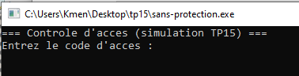
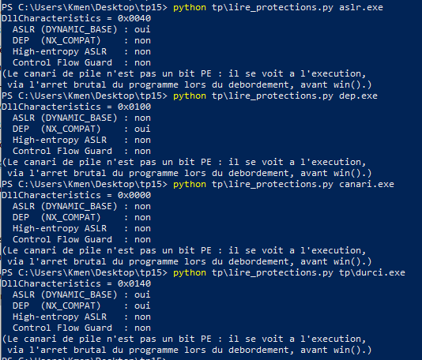
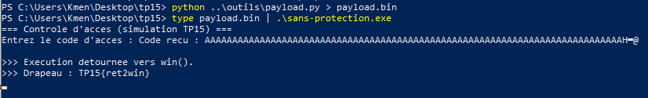
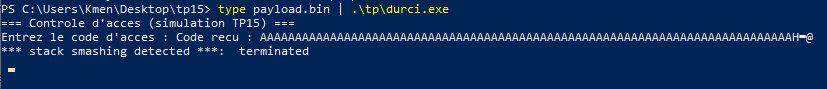
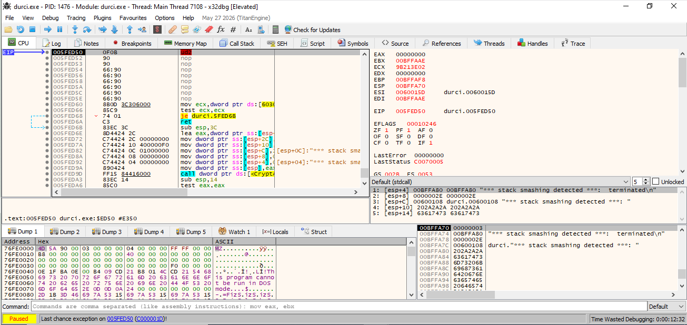

# 🛡️ TP15 — Travail individuel `tp15/tp/` : rapport

## 👀 Aperçu

Fenêtre de `sans-protection.exe` (et `tp\durci.exe`, même interface) : en attente du code d'accès.

## 📋 Contexte

Reprise du ret2win du Jour 3 contre des binaires dotés de protections mémoire modernes (canari, ASLR, DEP), pour voir laquelle bloque quoi.
Objectif : lire les protections de `tp/durci.exe`, rejouer la charge utile du Jour 3 contre lui, et expliquer protection par protection pourquoi l'attaque échoue.

## 🧭 Méthode

1. Compléter `tp/lire_protections.py` (masques ASLR/DEP) — fait :
   `ASLR_BIT = 0x0040`, `DEP_BIT = 0x0100`.
2. Lire les protections de chaque binaire (`sans-protection.exe`, `dep.exe`,
   `aslr.exe`, `canari.exe`, `tp/durci.exe`).
3. Refabriquer la charge utile du Jour 3 (`outils/motif.py` + `payload.py`,
   offset 76, adresse de `win()`), la rejouer contre `tp/durci.exe`.

## 📊 1. Tableau des protections

Lu avec `tp/lire_protections.py` sur chaque binaire :

| Binaire             | DllCharacteristics | ASLR          | DEP           | Canari (observé à l'exécution)           |
| ------------------- | ------------------ | ------------- | ------------- | ------------------------------------------- |
| sans-protection.exe | `0x0000`         | non           | non           | non                                         |
| aslr.exe            | `0x0040`         | **oui** | non           | non                                         |
| dep.exe             | `0x0100`         | non           | **oui** | non                                         |
| canari.exe          | `0x0000`         | non           | non           | **oui** (pas un bit PE, voir point 3) |
| tp/durci.exe        | `0x0140`         | **oui** | **oui** | **oui**                               |

## 💥 2. Résultat de l'attaque

Charge du Jour 3 (`OFFSET=76`, `WIN_ADDR=0x00401648`), rejouée telle quelle.

Contre `sans-protection.exe` : réussit, comme au Jour 3 — `TP15{ret2win}` :

Contre `tp/durci.exe` : bloqué net, aucun flag — le programme s'arrête sur `*** stack smashing detected ***` (le canari a détecté la corruption de la pile) :

Le crash a lieu **avant même** l'exécution de `win()` — sous x32dbg, EIP reste dans le code normal du programme (`durci.0005FED50`), pas détourné du tout :

## 🔍 3. Explication — ce qui bloque quoi

- **Canari** : une valeur sentinelle placée entre le tampon et l'adresse de retour est vérifiée juste avant que `vuln()` ne rende la main. Notre motif cyclique (`AAAA...`) écrase cette sentinelle en même temps que l'adresse de retour — la vérification échoue, le programme s'arrête (`stack smashing detected`) **avant** d'atteindre l'instruction `ret` qui aurait utilisé l'adresse corrompue. C'est ce qui bloque concrètement cette tentative précise.
- **ASLR** : même si le canari n'existait pas, l'adresse `0x00401648` qu'on a codée en dur dans `payload.py` ne correspondrait plus à l'adresse réelle de `win()` une fois le binaire chargé à une base aléatoire — le saut partirait dans le vide.
- **DEP** : sans objet ici contre *cette* attaque précise (on ne saute pas vers du code injecté sur la pile, mais vers une fonction légitime déjà marquée exécutable) — DEP protégerait contre une injection de shellcode, pas contre un ret2win.

## ✨ Bonus

Le **canari** seul suffirait à bloquer précisément cette attaque : elle porte directement sur l'adresse de retour (toute modification de la pile entre le tampon et cette adresse est détectée avant usage), peu importe que l'adresse visée soit prévisible ou non. L'ASLR seule ne suffirait pas de la même façon : elle rend `win()` imprévisible, mais un attaquant disposant d'une fuite d'adresse (information leak) pourrait recalculer la bonne valeur et recommencer — ce que le canari ne permet pas, puisqu'il détecte la corruption elle-même, pas seulement l'exactitude de la valeur visée.

## 💬 Réponse à la question de restitution

Aucune protection ne corrige le code : le `scanf` sans borne reste présent dans `durci.exe`, le débordement a toujours lieu. Ce qui change, c'est ce que l'attaquant peut **faire** de ce débordement : le canari détecte la corruption avant que l'adresse de retour corrompue serve, l'ASLR rend l'adresse de `win()` imprévisible même si l'adresse de retour est bien écrasée, et le DEP empêcherait l'exécution de code injecté (sans objet ici, puisqu'on saute vers du code légitime). Ce qui manque encore : corriger la lecture non bornée à la source — c'est l'objet du TP18.
