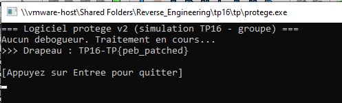
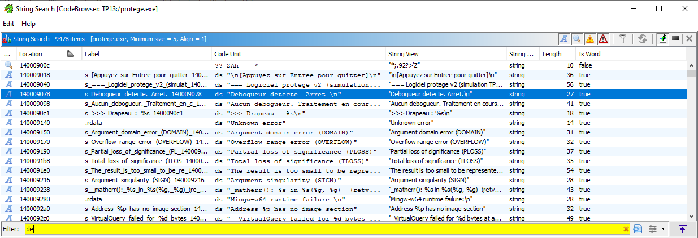
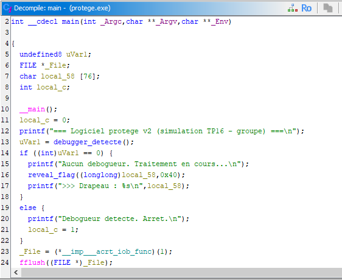
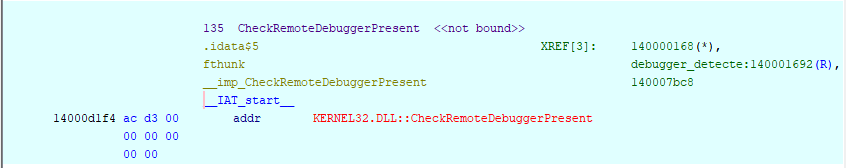
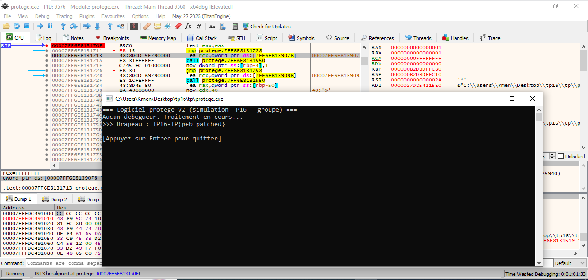
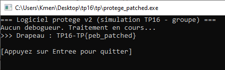
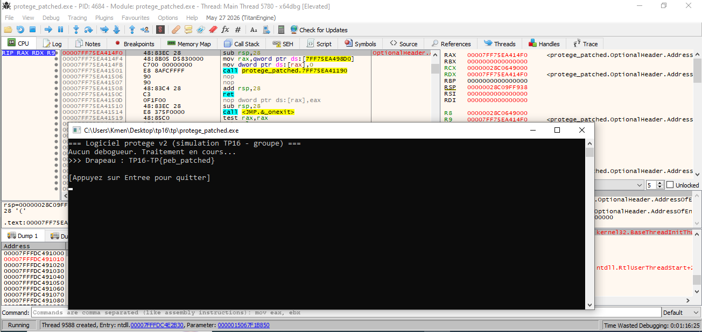

# 🛡️ TP16 — Travail individuel `tp16/tp/` : rapport

## 👀 Aperçu



Lancement direct de `tp16/tp/protege.exe`, **hors débogueur** : les deux contrôles (PEB puis `CheckRemoteDebuggerPresent`) répondent "pas de débogueur", donc le programme imprime directement le drapeau`TP16-TP{peb_patched}` et attend `Entrée` (`pause_fin()`). C'est le comportement de référence, sans aucune neutralisation — l'enjeu du TP est d'obtenir ce même résultat **en restant attaché à x64dbg**.

<!-- TODO capture restante : l'aperçu x64dbg (apercu.png) avec protege.exe
     ouvert et bloqué par l'anti-debug, perdu lors du remplacement du
     dossier tp16/ le 2026-11-13. À reprendre sur le nouveau binaire. -->

## 📋 Contexte

Cible : `tp16/tp/protege.exe`, qui détecte un débogueur attaché et s'arrête avant d'afficher son drapeau. Objectif : rester attaché avec x64dbg tout en obtenant le drapeau — neutraliser l'anti-debug, pas le contourner en se détachant.

## 🧭 Méthode

1. Lancer `protege.exe` dans x64dbg (ou s'y attacher), observer le blocage.
2. Ghidra, à froid : repérer les deux contrôles enchaînés (lecture directe de `BeingDebugged` dans le PEB, puis `CheckRemoteDebuggerPresent`), et lequel court-circuite l'autre.
3. Neutraliser (patch de la branche de décision, ou ScyllaHide).
4. Obtenir le drapeau, toujours attaché.

## 🔍 1. Vérifications identifiées (Ghidra)

Recherche de chaînes (Ctrl+Shift+E) : deux messages trouvés,
`"Debogueur detecte. Arret.\n"` et
`"Aucun debogueur. Traitement en cours...\n"` :



Le message "Debogueur detecte" est référencé depuis `main` (désormais à `0x1400016ea`, l'adresse a changé avec le nouveau fichier). Décompilation de
`main`, reconfirmée sur le nouveau binaire :



```c
int __cdecl main(int _Argc, char **_Argv, char **_Env)
{
  undefined8 uVar1;
  FILE *_File;
  undefined1 local_58 [76];
  int local_c;

  __main();
  local_c = 0;
  printf("=== Logiciel protege v2 (simulation TP16 - groupe) ===\n");
  uVar1 = debugger_detecte();
  if ((int)uVar1 == 0) {
    printf("Aucun debogueur. Traitement en cours...\n");
    reveal_flag((longlong)local_58, 0x40);
    printf(">>> Drapeau : %s\n", local_58);
  }
  else {
    printf("Debogueur detecte. Arret.\n");
    local_c = 1;
  }
  _File = (*__imp___acrt_iob_func)(1);
  fflush((FILE *)_File);
  pause_fin();
  return local_c;
}
```

Assembleur du point de décision :

```
0x14000170a: CALL debugger_detecte      ; protege.exe+170A
0x14000170f: TEST EAX, EAX              ; protege.exe+170F
0x140001711: JZ   0x140001728           ; protege.exe+1711 -> branche "Aucun debogueur" (flag)
```

Un seul point de décision compte : `(int)uVar1 == 0` juste après l'appel à `debugger_detecte()` — peu importe ce que les deux contrôles internes à cette fonction détectent, forcer `EAX` à `0` au retour de l'appel (ou rendre le `JZ` inconditionnel) suffit à défaire les deux d'un coup, exactement comme le suggère l'énoncé.

`debugger_detecte()` (à `0x140001660`) :

```c
undefined8 debugger_detecte(void)
{
  if (peb_being_debugged() == 0) {
    CheckRemoteDebuggerPresent(GetCurrentProcess(), &local_c);
    uVar2 = (local_c == 0) ? 0 : 1;
  } else {
    uVar2 = 1;
  }
  return uVar2;
}
```

`peb_being_debugged()` (à `0x14000162a`) lit directement `GS:[0x60]` (le PEB
en x64) puis déréférence `PEB+0x2` (`BeingDebugged`) :

```
0x14000163c: MOV RAX, qword ptr GS:[0x60]   ; -> PEB
0x140001654: MOVZX EAX, byte ptr [RAX + 2]  ; -> PEB.BeingDebugged
```

**Les deux contrôles sont bien enchaînés et le PEB court-circuite l'autre** : `debugger_detecte` n'appelle `CheckRemoteDebuggerPresent` (import `KERNEL32.DLL`, IAT référencée depuis `0x140001692`/appel à`0x140001699` — voir la vue Listing Ghidra ci-dessous) que **si**`peb_being_debugged()` a répondu `0` (pas de débogueur).

 Si le PEB répond "débogué", la fonction retourne `1`immédiatement sans jamais appeler `CheckRemoteDebuggerPresent` — neutraliser uniquement ce second contrôle ne servirait donc à rien tant que le PEB signale un débogueur, exactement comme l'indique l'énoncé.

## 🛠️ 2. Méthode de neutralisation

Point d'arrêt sur `protege.exe+170F` (juste après le `CALL debugger_detecte`,
instruction `TEST EAX,EAX`). Deux approches testées :

- **Forcer `EAX = 0` au point d'arrêt** (commande `eax=0` dans la barre de
  commande x64dbg) : fonctionne, mais il faut reposer la valeur à chaque
  nouveau run — un restart sans repasser la commande fait retomber sur la
  branche "Debogueur detecte".
- **Patch de l'instruction `JE` en `JMP` inconditionnel** (retenu) :
  sélection de la ligne `JE protege.<base>+1728` → `Espace` (Assembler) →
  `jmp 0x<adresse de la cible, ex. 7FF6E8131728>` → `OK`. Le saut devient
  inconditionnel, donc peu importe ensuite la valeur d'EAX (ici `1`,
  débogueur bien détecté), le flux va toujours vers la branche "Aucun
  debogueur". Plus robuste : indépendant du timing, valable pour toute la
  session de debug.

## 🏁 3. Drapeau obtenu



Capture prise avec les deux fenêtres visibles simultanément : x64dbg
toujours attaché (process `protege.exe` PID 9576, patch `JMP` actif sur
`protege.<base>+1711`, breakpoint encore marqué) **et** la console du
programme affichant :

```
=== Logiciel protege v2 (simulation TP16 - groupe) ===
Aucun debogueur. Traitement en cours...
>>> Drapeau : TP16-TP{peb_patched}
```

Le débogueur n'a jamais été détaché — seule la décision prise par `main`
après l'appel à `debugger_detecte()` a été forcée.

## ✨ Bonus

Patch permanent sur le fichier, dans x64dbg :

1. Sauvegarde de l'original : `cp protege.exe protege.orig.exe` (dans `tp16\tp\`).
2. Avec le patch `JE→JMP` déjà posé en mémoire sur `protege.exe+1711`,
   `File → Patch File...` : la fenêtre `Patches` liste la seule modification
   effectuée, `00007FF6E8131711: 74->EB` (l'octet du `JE` conditionnel
   devenu `JMP` court).
3. `Patch File` → enregistrement sous `protege_patched.exe` (à côté de
   l'original, sans l'écraser).

**Vérification en deux temps :**



Lancé directement (hors débogueur), `protege_patched.exe` affiche le
drapeau — mais ça ne prouve rien à soi seul, puisque l'original non patché
fait pareil sans débogueur attaché (cf. `sans-debogueur-ok.png`).



La vraie preuve : `protege_patched.exe` ouvert **dans x64dbg** (`File → Open`), exécuté sans poser aucun point d'arrêt ni modifier aucun registre — le patch gravé dans le fichier suffit à lui seul à toujours prendre la branche "Aucun debogueur", même sous débogueur.

**Pourquoi patcher le fichier plutôt que la mémoire à chaque run :** un analyste qui doit rejouer souvent la même cible (tests répétés, séances de TP, démonstration) ne veut pas reposer le même patch (breakpoint + édition de registre/instruction) à chaque lancement. Patcher le fichier une fois rend la neutralisation permanente et reproductible, au prix de garder une copie de l'original pour revenir en arrière si besoin (ici`protege.orig.exe`).

## 💬 Réponse à la question de restitution

Un anti-debug ne peut que **ralentir** l'analyse, jamais l'empêcher vraiment : toute vérification qu'il fait tourne dans un environnement que l'analyste contrôle entièrement (mémoire lisible et modifiable, flux d'exécution patchable). Enchaîner deux contrôles différents (PEB puis API) augmente le coût de l'analyse — il faut les trouver tous les deux — mais ne change pas la nature du problème : rien côté client ne peut empêcher quelqu'un qui contrôle la machine de lire ou de modifier le programme qui y tourne.
