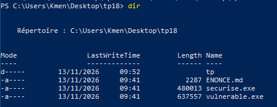
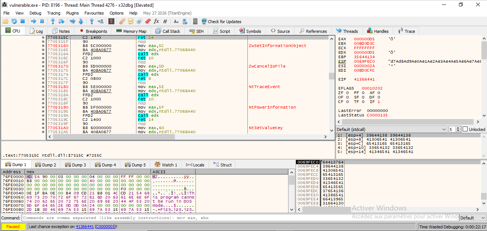
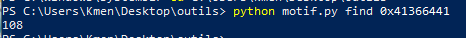
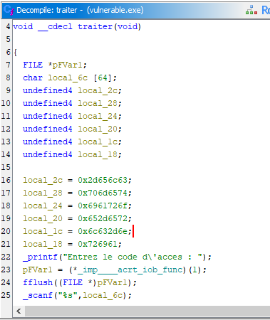
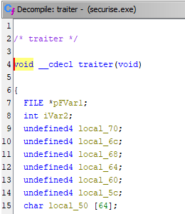
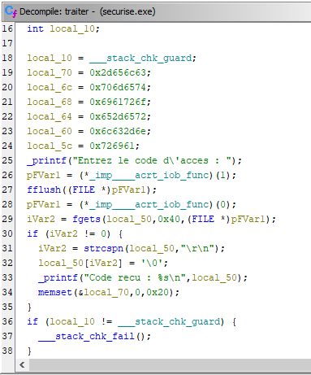
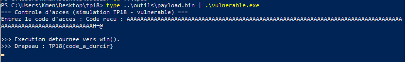
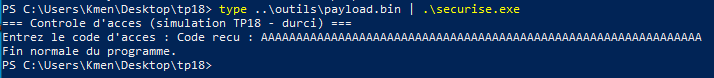
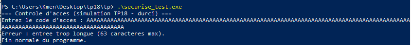

# 🔒 TP18 — Travail individuel `tp18/tp/` : rapport

## 👀 Aperçu



Vue d'ensemble du dossier `tp18\` : `vulnerable.exe` (fautif) et
`securise.exe` (corrigé, fourni pour vérifier le raisonnement) à comparer
avec la même charge, et `tp\securise.c` à compléter.

## 📋 Contexte

Correction à la source du programme vulnérable des jours précédents, par deux changements ciblés dans `tp/securise.c` : lecture bornée (`fgets` au lieu de `scanf("%s", ...)`) et effacement du secret en mémoire (`memset`) avant la fin de la fonction. Vérification en rejouant le ret2win contre `vulnerable.exe` (marche) et `securise.exe` (ne marche plus).

## 🧭 Méthode

1. Compléter `tp/securise.c` (fait, voir ci-dessous).
2. Mesurer le décalage avec `outils/motif.py` contre `vulnerable.exe` (différent du Jour 3 — ce programme a un champ `secret` en plus) :

   ```powershell
   python motif.py gen 200 > motif.bin
   type ..\outils\motif.bin | .\vulnerable.exe
   ```

   Crash observé **sous x32dbg** (débogage JIT, interception automatique
   de l'exception) :
   
   `EIP = 41366441`, puis :
   ```powershell
   python motif.py find 0x41366441
   ```

   
   → **108**, re-mesuré nous-mêmes (pas seulement recopié depuis
   `outils/README.md`, qui donnait la même valeur en exemple).
3. Fabriquer la charge (`outils/payload.py`, `OFFSET=108`, adresse de `win()`), l'envoyer aux deux binaires.

## 🛠️ 1. Corrections apportées

### 🚦 Point de départ réellement observé

Le fichier `tp/securise.c`, tel que trouvé avant toute modification,
avait en réalité le **TODO(1) déjà fait** (`fgets` déjà actif, aucune
ligne `scanf`) et **seul le TODO(2) restait à faire** (`memset`
commenté) :

```c
static void traiter(void)
{
    char secret[32];
    char buf[64];

    strcpy(secret, "cle-temporaire-en-clair");
    printf("Entrez le code d'acces : ");
    fflush(stdout);

    /* TODO(1) : remplacer la lecture non bornee par une lecture BORNEE.
       - Supprimez la ligne scanf ci-dessous.
       - Activez (decommentez) le fgets, qui ne lit jamais plus que la taille
         du tampon. */
    fgets(buf, sizeof(buf), stdin);
    buf[strcspn(buf, "\r\n")] = '\0';

    printf("Code recu : %s\n", buf);

    /* TODO(2) : effacer le secret de la memoire avant de quitter la fonction. */
    /* memset(secret, 0, sizeof(secret)); */     /* <<< A ACTIVER   */
    (void)secret;
}
```

Le commentaire du TODO(1) décrit un `scanf("%s", buf)` à supprimer, mais
cette ligne n'était déjà plus présente dans le fichier reçu — seule la
trace du commentaire en témoigne. Pour référence, ce `scanf` non borné
est bien celui de `vulnerable.c` (confirmé en Ghidra ci-dessous) :
identique, aucune limite de taille, c'est la faille exploitée en
TP14/TP15. `secret`, lui, n'était pas encore effacé : il restait lisible
en mémoire tant que le process tournait, c'est la faille exploitée en
TP11–TP13. Notre contribution réelle sur les deux TODO porte donc
seulement sur le TODO(2) ; le TODO(1) a été vérifié (correct, conforme à
l'énoncé) plutôt que refait.

### ✔️ Code complété (les deux TODO faits)

```c
static void traiter(void)
{
    char secret[32];
    char buf[64];

    strcpy(secret, "cle-temporaire-en-clair");
    printf("Entrez le code d'acces : ");
    fflush(stdout);

    fgets(buf, sizeof(buf), stdin);
    buf[strcspn(buf, "\r\n")] = '\0';

    printf("Code recu : %s\n", buf);

    memset(secret, 0, sizeof(secret));
}
```

- **TODO(1)** : `fgets(buf, sizeof(buf), stdin)` ne lit jamais plus que la
  taille de `buf` (64 octets), contrairement à `scanf("%s", buf)` qui
  l'ignore — neutralise le débordement de tampon.
- **TODO(2)** : `memset(secret, 0, sizeof(secret))` efface le secret de la
  mémoire avant que la fonction ne rende la main — neutralise sa lecture
  après coup.

*(Version finale retenue dans le fichier, avec durcissement supplémentaire : voir le Bonus plus bas.)*

### 🔍 Vérification Ghidra (décompilation des deux binaires fournis)

Pour confirmer que ces corrections sont bien celles réellement compilées
dans les binaires fournis par le prof — pas juste supposées depuis la
source :



`vulnerable.exe` : `traiter()` décompilée confirme `scanf("%s", local_6c)`
non borné, `secret` (24 octets, `"cle-temporaire-en-clair"`) stocké juste
avant `buf` (64 octets) sur la pile, aucun canari. `win()` est à
`0x401648` — exactement l'adresse donnée en exemple dans
`outils/README.md`.




`securise.exe` : `traiter()` décompilée confirme bien `fgets(buf, 0x40, stdin)`, `strcspn` pour couper `\r\n`, puis `memset(secret, 0, 0x20)` —
identique à `securise.c`. Canari de pile actif
(`___stack_chk_guard`/`___stack_chk_fail`), cohérent avec la compilation
"AVEC protections" mentionnée dans l'en-tête du fichier source.

**Point relevé en vérifiant l'assembleur (pas juste la source) :** dans le binaire compilé `securise.exe`, le `memset(secret, ...)` n'est exécuté que **si `fgets` a réussi** (`if (iVar2 != 0) { ...; memset(...); }`). Si `fgets` échoue (EOF, flux fermé), le secret n'est jamais effacé. Ce n'est pas un des deux TODO demandés par l'énoncé — `securise.exe` est fourni tel quel, pas recompilé par nous — mais c'est une limite réelle de cette correction, corrigée dans notre propre `tp/securise.c` (voir Bonus ci-dessous).

## ✅ 2. Vérification : même charge, deux résultats

Charge fabriquée avec `outils/payload.py` (`OFFSET = 108`, `WIN_ADDR = 0x00401648`), envoyée telle quelle aux deux binaires :

```powershell
python payload.py > payload.bin
type ..\outils\payload.bin | .\vulnerable.exe
type ..\outils\payload.bin | .\securise.exe
```



`vulnerable.exe` : le flux saute bien vers `win()` — `">>> Execution detournee vers win()."` puis `">>> Drapeau : TP18{code_a_durcir}"`.



`securise.exe` : la **même** charge est simplement tronquée par `fgets`
(`"Code recu : AAAAAAAA..."`, coupée à la taille du tampon) et le
programme termine normalement (`"Fin normale du programme."`) — `win()`
n'est jamais atteint.

## 📊 3. Tableau correction → attaque neutralisée

| Correction                           | Attaque neutralisée                                                            |
| ------------------------------------ | ------------------------------------------------------------------------------- |
| Lecture bornée (`fgets` + taille) | Débordement de tampon / ret2win (TP14, TP15)                                   |
| Effacement du secret (`memset`)    | Lecture du secret en RAM (TP11–TP13 : Cheat Engine, dump mémoire, débogueur) |

## ✨ Bonus

En relisant `tp/securise.c` instruction par instruction (pas juste les deux TODO), deux points supplémentaires ont été corrigés :

1. Le code ne testait **pas** la valeur de retour de `fgets` : en cas d'échec de lecture (EOF, flux fermé), `buf` restait non initialisé et était quand même passé à `strcspn`/`printf` — un bug réel, distinct des deux TODO mais réel.
2. Suite à ça, le `memset(secret, ...)` ne s'exécutait que sur le chemin normal. Il s'exécute maintenant sur **tous** les chemins de sortie, corrigeant au passage une limite observée dans `securise.exe` lui-même (voir section 1).

Ajout demandé par le bonus — **validation de longueur explicite** : si `fgets` n'a trouvé aucune fin de ligne alors que le tampon est totalement rempli, l'entrée dépassait `sizeof(buf)` et a été tronquée silencieusement. On le détecte, on vide le reste de la ligne dans `stdin` (pour ne pas polluer une lecture suivante), et on affiche un message d'erreur clair :

**Vérifié réellement** (pas juste en théorie) — l'énoncé précise que la
compilation n'est pas requise pour ce TP (`vulnerable.exe`/`securise.exe`
sont fournis tout faits) ; ceci va donc au-delà du livrable demandé,
uniquement pour prouver le comportement du Bonus faute de binaire fourni
qui l'implémente : `securise.c` compilé avec `gcc` (`w64devkit`, GCC
16.2.0) via `gcc securise.c -o securise_test.exe`, sans erreur ni warning,
puis exécuté avec une entrée de plus de 63 caractères :



```
=== Controle d'acces (simulation TP18 - durci) ===
Entrez le code d'acces : AAAAAAAA...AAAAAAAA
Erreur : entree trop longue (63 caracteres max).
Fin normale du programme.
```

```c
static void traiter(void)
{
    char secret[32];
    char buf[64];
    size_t len;
    int c;

    strcpy(secret, "cle-temporaire-en-clair");
    printf("Entrez le code d'acces : ");
    fflush(stdout);

    if (fgets(buf, sizeof(buf), stdin) == NULL) {
        printf("Erreur de lecture.\n");
        memset(secret, 0, sizeof(secret));
        return;
    }

    len = strcspn(buf, "\r\n");

    if (buf[len] == '\0' && len == sizeof(buf) - 1) {
        while ((c = getchar()) != '\n' && c != EOF) { /* purge */ }
        printf("Erreur : entree trop longue (%zu caracteres max).\n",
               sizeof(buf) - 1);
        memset(secret, 0, sizeof(secret));
        return;
    }

    buf[len] = '\0';
    printf("Code recu : %s\n", buf);
    memset(secret, 0, sizeof(secret));
}
```

**Pourquoi "échouer proprement" fait partie du code sécurisé :** une entrée trop longue n'est pas un cas anormal à ignorer, c'est une entrée attendue qu'il faut *gérer*. La traiter silencieusement (tronquer sans le dire) cache un problème à l'utilisateur et, plus grave en sécurité, habitue le code à avaler des entrées hors contrat sans jamais le signaler — exactement le genre de permissivité qui, ailleurs dans la même base de code, se transforme en faille exploitable. Un message d'erreur explicite, une entrée
rejetée plutôt que coupée en silence, et un état interne remis à zéro (`secret` effacé même sur le chemin d'erreur) : c'est ça, échouer proprement.

## 💬 Réponse à la question de restitution

**Si vraiment forcé à n'en garder qu'un, je choisirais les protections (TP15).** Raison concrète, pas théorique : dans ce TP même, le `memset` conditionnel de `securise.exe` et l'absence de vérification du retour de `fgets` dans notre propre `securise.c` de départ nous ont échappé à la première lecture — il a fallu redescendre en assembleur pour les voir.
La revue de code humaine est faillible, y compris la nôtre, sur ce TP précis. Des protections actives (canari, ASLR, DEP) neutralisent l'exploitation d'une classe entière de bugs mémoire même quand on n'a pas vu le bug — elles couvrent l'angle mort que la relecture ne couvre pas.

**Mais la bonne réponse est « les deux », pas substituables :** les protections ne corrigent rien — le bug reste présent, peut toujours planter le programme, et un bug d'une autre nature (logique, fuite d'information comme le secret lu en RAM ici) leur échappe entièrement, puisqu'elles ne protègent que contre certaines classes d'exploitation mémoire. Un code correct (TP18) retire le bug lui-même, à la racine, mais sans protections, un bug qui échappe quand même à la revue reste pleinement exploitable. Les protections sont un filet pour les bugs qu'on n'a pas vus ; le code correct retire le danger qu'on a vu. Les deux ensemble réduisent le risque bien plus que chacun seul — c'est pour ça qu'un choix forcé entre les deux est, par construction, un mauvais choix.
