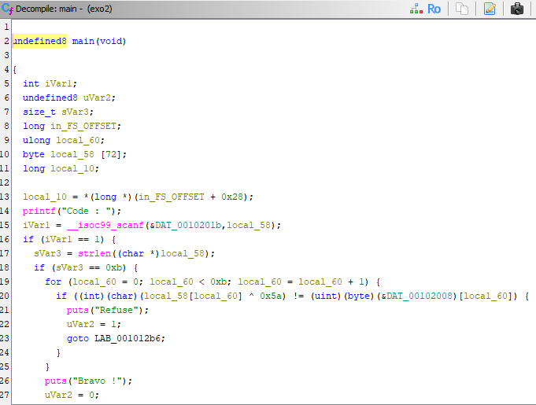
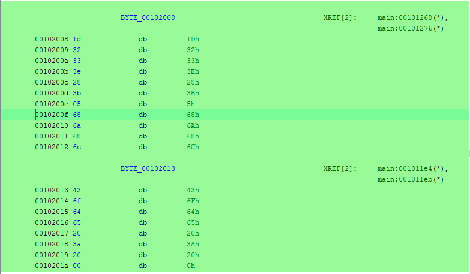
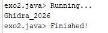
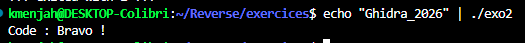

# 🐉 Exercice exo2 : retrouver le code avec Ghidra

Binaire analysé : `exo2` (ELF 64 bits PIE, x86-64, strippé).
Objectif : trouver le code qui fait afficher « Bravo ! ».
Outil utilisé : Ghidra 12.1.4 uniquement (analyse statique).

## 📥 1. Import et analyse

1. Créer un projet Ghidra, importer `exo2` (format ELF, x86-64 détecté automatiquement).
2. Ouvrir le programme dans le CodeBrowser et lancer l'analyse avec les options par défaut.

## 🎯 2. Trouver `main`

Le binaire est strippé : aucune fonction ne s'appelle `main`.

1. Symbol Tree, ouvrir `entry`.
2. Dans le décompilé, `entry` appelle `__libc_start_main`. Son **premier argument** est l'adresse de `main` : `FUN_001011c9`.
3. Double-clic sur `FUN_001011c9`, puis `L` pour la renommer en `main`.

## 📖 3. Lire `main`

Le décompilé montre :

- `printf("Code : ")` puis `scanf(&DAT_0010201b, local_58)` : lecture de l'entrée.
  `DAT_0010201b` est seulement le format du `scanf`.
- `strlen(local_58) == 0xb` : le code fait **11 caractères**.
- une boucle `for (i = 0; i < 0xb; i++)` qui teste, pour chaque caractère :
  `(local_58[i] ^ 0x5a) != (&DAT_00102008)[i]`
- si un test échoue : `puts("Refuse")`. Si toute la boucle passe : `puts("Bravo !")`.

Le code n'est donc pas stocké en clair : chaque caractère est combiné par XOR avec `0x5a`
et comparé à un tableau de 11 octets situé à l'adresse `0x00102008`.

Le Listing confirme avec l'instruction `XOR EAX, 0x5a` suivie de `CMP EDX, EAX`.



## 📄 4. Lire le tableau

Double-clic sur `DAT_00102008` pour aller dans `.rodata`, puis définir 11 octets
(clic droit, Data, byte). Valeurs relevées :

```
1d 32 33 3e 28 3b 05 68 6a 68 6c
```



## 🧮 5. Décoder avec un script Ghidra

Le XOR est sa propre inverse : `caractère = octet ^ 0x5a`.
Script Manager, nouveau script Java `exo2.java` :

```java
import ghidra.app.script.GhidraScript;

public class exo2 extends GhidraScript {
    @Override
    public void run() throws Exception {
        StringBuilder sb = new StringBuilder();
        for (int i = 0; i < 11; i++) {
            int b = getByte(toAddr(0x00102008 + i));
            sb.append((char) ((b ^ 0x5a) & 0xff));
        }
        println(sb.toString());
    }
}
```

Le nom de la classe doit être identique au nom du fichier.
Exécution (triangle vert) : la console affiche le code décodé `Ghidra_2026`.



## ✅ 6. Validation

```
echo "Ghidra_2026" | ./exo2
```

→ `Code : Bravo !`



## 🏁 Résultat

Code : **`Ghidra_2026`**

Méthode : retrouver `main` depuis `entry`, lire la boucle de vérification (longueur 11,
XOR `0x5a`, tableau à `0x00102008`), puis inverser le XOR avec un script Ghidra.
