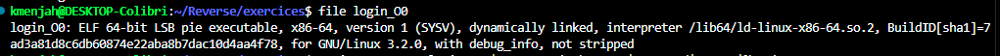
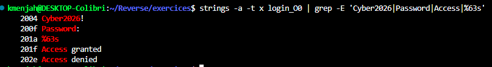
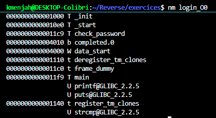
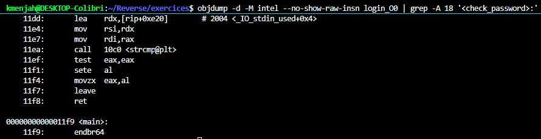
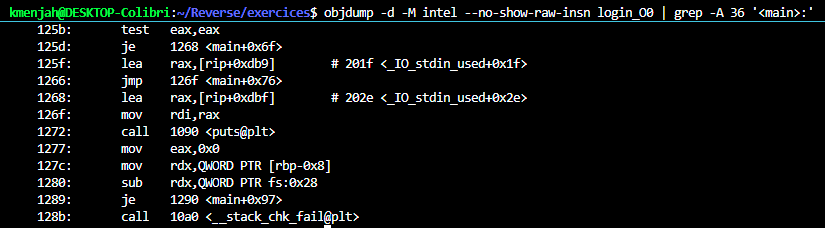
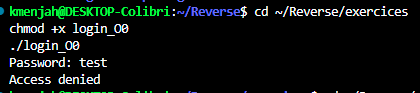
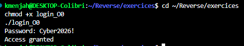
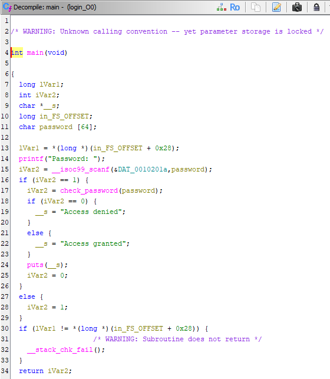
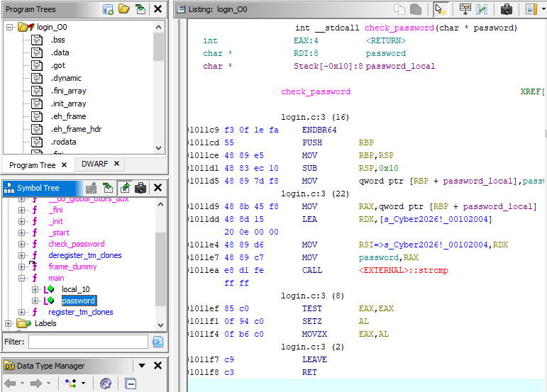

# 🔑 Analyse du binaire `login_O0`

## 📋 Ce que fait le binaire

`login_O0` est un programme de vérification de mot de passe : il affiche `Password: `, lit une saisie (`%63s`),
la compare avec `strcmp` (fonction `check_password`) à un mot de passe codé en dur, puis affiche
`Access granted` ou `Access denied`.

**Mot de passe : `Cyber2026!`**

## 🔍 1. `file`

```
file login_O0
```

`file` identifie le type du fichier à partir de son contenu (format, architecture, présence de symboles).



Binaire ELF 64 bits, compilé avec les infos de débogage et non strippé : les noms de fonctions sont conservés,
ce qui permet d'utiliser `nm` et `objdump`.

## 🔤 2. `strings`

```
strings -a -t x login_O0 | grep -E 'Cyber2026|Password|Access|%63s'
```

`strings -a` extrait les textes lisibles de tout le fichier, `-t x` ajoute leur offset en hexadécimal, et `grep -E` ne garde que les lignes contenant l'un des motifs.



`Cyber2026!` (offset `0x2004`) n'est ni un message ni un format : c'est le candidat pour le mot de passe.
`strings` ne prouve pas son rôle, `objdump` le confirme.

## 🧩 3. `nm`

```
nm login_O0
```

`nm` liste les symboles du binaire (fonctions et variables) avec leur adresse et leur type : `T` = défini dans le code, `U` = importé d'une bibliothèque.



Deux fonctions de l'auteur, `main` et `check_password`, et un appel importé à `strcmp` : le programme compare deux chaînes.

## ⚙️ 4. `objdump`

```
objdump -d -M intel --no-show-raw-insn login_O0 | grep -A 18 '<check_password>:'
```

`objdump -d` désassemble le code, `-M intel` utilise la syntaxe Intel, `--no-show-raw-insn` masque les octets bruts ; `grep -A 18` affiche la ligne `<check_password>:` et les 18 lignes qui suivent.



`check_password` appelle `strcmp` avec l'adresse `0x2004` (`Cyber2026!`) et la saisie, puis renvoie 1 si les chaînes sont égales.
Cela confirme le mot de passe.

```
objdump -d -M intel --no-show-raw-insn login_O0 | grep -A 36 '<main>:'
```

Même commande, avec `grep -A 36` pour afficher `<main>:` et les 36 lignes suivantes.



Selon le résultat de `check_password`, `main` affiche la chaîne `0x202e` (`Access denied`) ou `0x201f` (`Access granted`).

## ✅ 5. Validation par exécution

Après `chmod +x login_O0` (ajoute le droit d'exécution) puis `./login_O0` (lance le programme) :





## 🐉 6. Vérification avec Ghidra (facultatif)

Ghidra n'est pas un outil binutils, il confirme seulement les résultats précédents.





## 🏁 Conclusion

| Outil | Apport |
|---|---|
| `file` | type de binaire, non strippé avec infos de débogage |
| `strings` | messages et candidat mot de passe `Cyber2026!` |
| `nm` | fonctions `main` et `check_password`, appel à `strcmp` |
| `objdump` | confirmation : `strcmp(saisie, "Cyber2026!")` |
| exécution | preuve : `Cyber2026!` donne `Access granted` |

Le mot de passe est stocké en clair dans `.rodata` : un simple `strings` suffit à le retrouver.
