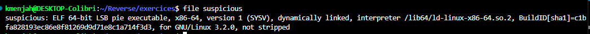
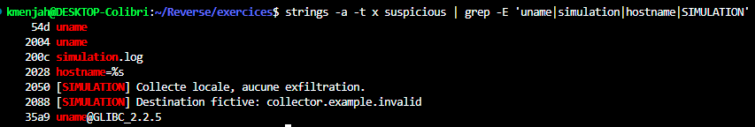
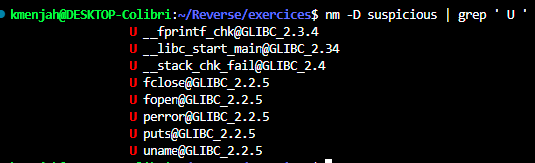
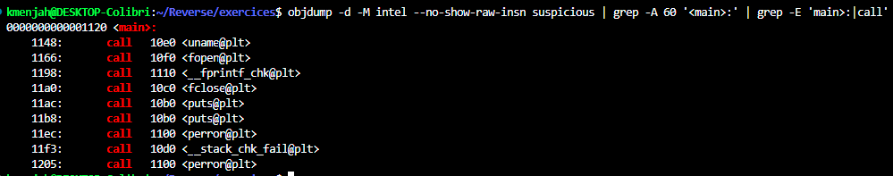
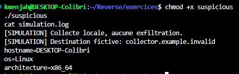
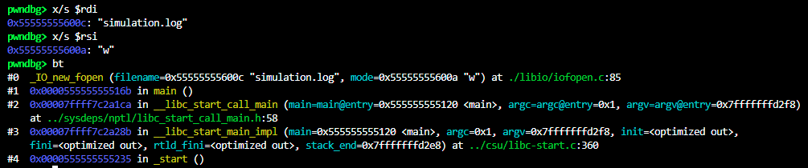
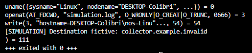
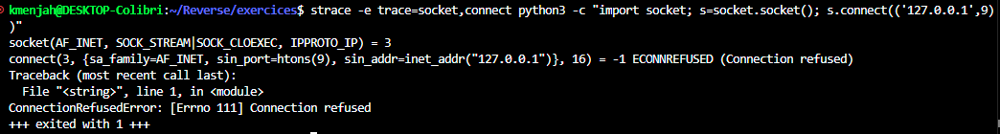

# 🕵️ Analyse du binaire `suspicious`

## 📋 Ce que fait le binaire

`suspicious` imite la collecte d'informations d'une machine, sans rien envoyer. Il appelle `uname` pour lire le nom
de la machine, le système et l'architecture, les écrit dans un fichier local `simulation.log`, puis affiche deux messages
`[SIMULATION]` : « Collecte locale, aucune exfiltration » et « Destination fictive: collector.example.invalid ».

L'analyse est d'abord **statique** (parties 1 à 4), puis le binaire est exécuté pour confirmer (partie 5). Les imports vérifiés plus haut montrent qu'il n'a aucune fonction réseau, ce qui rend l'exécution sans risque.

## 🔍 1. `file`

```
file suspicious
```

`file` identifie le type du fichier à partir de son contenu (format, architecture, présence de symboles).



Binaire ELF 64 bits non strippé : les noms de fonctions sont conservés.

## 🔤 2. `strings`

```
strings -a -t x suspicious | grep -E 'uname|simulation|hostname|SIMULATION'
```

`strings -a` extrait les textes lisibles de tout le fichier, `-t x` ajoute leur offset en hexadécimal, `grep -E` ne garde que les lignes qui contiennent l'un des motifs.



Le fichier de sortie `simulation.log`, les formats `hostname=%s`, `os=%s`, `architecture=%s` et les deux messages `[SIMULATION]`
indiquent déjà l'intention. Le domaine `collector.example.invalid` est fictif : `.invalid` est réservé et ne peut jamais exister.

## 🧩 3. `nm`

```
nm -D suspicious | grep ' U '
```

`nm -D` liste les symboles dynamiques, `U` désigne les fonctions importées de la libc, et `grep` ne garde que celles-ci.



Fonctions importées : `uname`, `fopen`, `__fprintf_chk`, `fclose`, `puts`, `perror`. Il n'y a **aucune fonction réseau**
(`socket`, `connect`, `send`...) : le programme ne peut pas envoyer de données hors de la machine.

## ⚙️ 4. `objdump`

```
objdump -d -M intel --no-show-raw-insn suspicious | grep -A 60 '<main>:' | grep -E 'main>:|call'
```

`objdump -d` désassemble le code, `-M intel` utilise la syntaxe Intel, `--no-show-raw-insn` masque les octets bruts, `grep -A 60` affiche `<main>:` et les 60 lignes suivantes, et le second `grep` ne garde que l'en-tête de `main` et ses appels de fonctions (`call`).



`main` appelle `uname`, puis `fopen("simulation.log", "w")`, `fprintf`, `fclose` et deux fois `puts` : lecture des informations système, écriture dans un fichier local, puis affichage des deux messages. Les `perror` ne servent qu'en cas d'erreur de `uname` ou de `fopen`.

## ✅ 5. Exécution

```
chmod +x suspicious
./suspicious
cat simulation.log
```

`chmod +x` ajoute le droit d'exécution, `./suspicious` lance le programme, `cat` affiche le fichier qu'il a créé dans le dossier courant.



Le résultat correspond à l'analyse statique : les deux messages `[SIMULATION]` sont affichés et `simulation.log` contient le nom de la machine, le système et l'architecture. Aucune connexion réseau n'est ouverte.

## 🐞 6. Vérification dynamique avec `gdb`

```
gdb -q ./suspicious
break fopen
run
x/s $rdi
x/s $rsi
bt
```

`gdb -q` lance le débogueur sans sa bannière, `break fopen` arrête le programme juste avant l'ouverture du fichier, `run` le lance, `x/s $rdi` et `x/s $rsi` affichent en texte les deux premiers arguments de `fopen` (nom du fichier et mode), et `bt` montre d'où `fopen` est appelé.



Le programme s'arrête dans `fopen` appelé depuis `main`, avec les arguments `"simulation.log"` et `"w"` : il écrit dans un fichier local, ce qui confirme l'analyse statique. `quit` quitte `gdb`.

## 📡 7. Appels système avec `strace`

```
strace -e trace=uname,openat,write,connect,socket ./suspicious 2>&1 | grep -v -E 'ld.so|libc.so|locale'
```

`strace` affiche les appels système que le programme fait avec le noyau, `-e trace=...` ne garde que `uname`, `openat`, `write`, `connect` et `socket`, et `grep -v` retire le chargement des bibliothèques.



`uname` lit les informations de la machine, `openat` crée `simulation.log` en écriture seule et `write` y écrit 54 octets. Aucun `socket` ni `connect` n'apparaît : le programme n'ouvre aucune connexion réseau, ce qui confirme que l'exfiltration est bien simulée.

Pour vérifier que le filtre affiche bien `socket` et `connect` quand ils existent, on le teste sur un programme qui tente une connexion (vers la machine locale, sans rien envoyer à l'extérieur) :

```
strace -e trace=socket,connect python3 -c "import socket; s=socket.socket(); s.connect(('127.0.0.1',9))"
```



Les lignes `socket` et `connect` apparaissent ici (l'erreur `ECONNREFUSED` signifie seulement que rien n'écoute sur ce port) : leur absence pour `suspicious` est donc bien significative.

## 🏁 Conclusion

| Outil       | Apport                                                                          |
| ----------- | ------------------------------------------------------------------------------- |
| `file`    | ELF 64 bits non strippé                                                        |
| `strings` | fichier `simulation.log`, informations collectées, messages `[SIMULATION]` |
| `nm`      | imports : `uname`, `fopen`, `fprintf`, aucun appel réseau                |
| `objdump` | flux : `uname`, écriture dans le fichier local, deux messages                |

Le binaire est une **simulation inoffensive** : il collecte trois informations système, les écrit dans un fichier local et
n'envoie rien. Un vrai programme malveillant aurait des imports réseau, ce qui n'est pas le cas ici.
