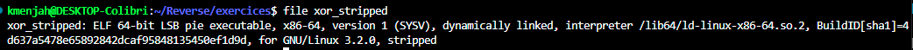
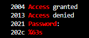
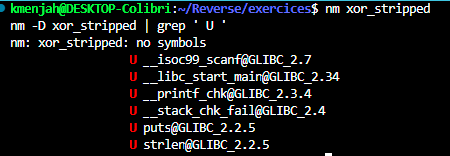
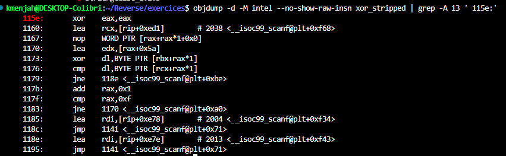
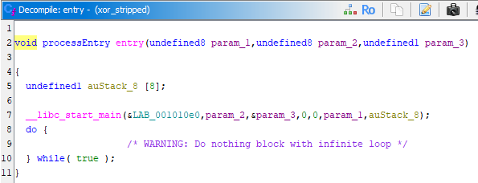
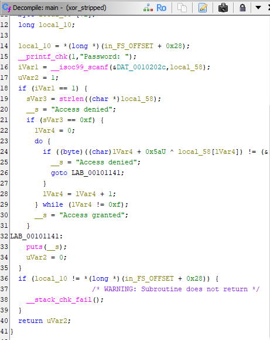
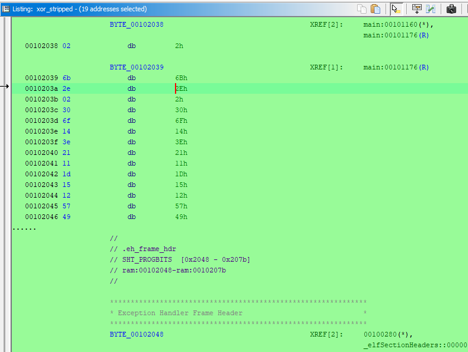
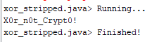
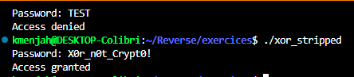

# 🔐 Analyse du binaire `xor_stripped`

Objectif : comprendre ce que fait le binaire et retrouver le mot de passe, d'abord avec les outils binutils, puis avec Ghidra. Le binaire est **strippé** : il n'a aucun nom de fonction.

## 📋 Ce que fait le binaire

`xor_stripped` demande un mot de passe (`Password: `), lit une saisie (`%63s`) et affiche `Access granted` ou
`Access denied`. Le mot de passe n'est pas stocké en clair : la saisie est transformée par un XOR dont la clé change à chaque caractère, puis comparée octet par octet à un tableau de 15 octets.

**Mot de passe : `X0r_n0t_Crypt0!`**

## 🔍 1. `file`

```
file xor_stripped
```

`file` identifie le type du fichier à partir de son contenu (format, architecture, présence de symboles).



ELF 64 bits PIE, marqué `stripped` : la table des symboles a été supprimée.

## 🔤 2. `strings`

```
strings -a -t x xor_stripped | grep -E 'Password|Access|%63s'
```

`strings -a` extrait les textes lisibles, `-t x` ajoute leur offset en hexadécimal, `grep -E` garde les lignes qui contiennent l'un des motifs.



On trouve les messages et le format `%63s`, mais **aucun mot de passe en clair** : `strings` ne suffit pas.

## 🧩 3. `nm`

```
nm xor_stripped
nm -D xor_stripped | grep ' U '
```

`nm` liste les symboles ; `-D` ne considère que les symboles dynamiques (imports de la libc), et `U` désigne les fonctions importées.



Le premier `nm` répond « no symbols » : aucune fonction du programme n'a de nom. Les imports montrent `scanf`, `printf`, `puts` et `strlen`, mais **pas de `strcmp`** : le programme ne compare pas deux chaînes avec la libc, il fait la comparaison lui-même.

## ⚙️ 4. `objdump`

```
objdump -d -M intel --no-show-raw-insn xor_stripped | grep -A 13 ' 115e:'
```

`objdump -d` désassemble le code, `-M intel` utilise la syntaxe Intel, `--no-show-raw-insn` masque les octets bruts, et `grep -A 13` affiche l'adresse `115e` et les 13 lignes suivantes.



La boucle de `0x1170` à `0x1183` calcule `(i + 0x5a) XOR saisie[i]` (`lea edx,[rax+0x5a]` puis `xor dl,...`), le compare à l'octet `i` du tableau situé à `0x2038`
(`lea rcx,[rip+0xed1] # 2038`) et recommence 15 fois (`cmp rax,0xf`). Avant la boucle, `cmp rax,0xf` sur le résultat de `strlen` impose une saisie de 15 caractères.

Le tableau se lit avec `xxd -s 0x2038 -l 15 xor_stripped` : `02 6b 2e 02 30 6f 14 3e 21 11 1d 15 12 57 49`.

## 🐉 5. Ghidra

### 🎯 Retrouver `main`

Dans Symbol Tree, ouvrir `entry` : le premier argument de `__libc_start_main` est l'adresse de `main`. Ici Ghidra l'affiche comme une étiquette, `&LAB_001010e0`, et non comme une fonction : il n'a pas reconnu `main` tout seul.



Double-clic sur `LAB_001010e0` pour aller à cette adresse, puis `F` (Create Function) pour créer la fonction et `L` pour la renommer en `main`.
Il ne faut pas double-cliquer sur `__libc_start_main` : c'est une fonction de la libc, importée, sans code dans le binaire.



Le décompilé confirme l'analyse : longueur de 15 (`0xf`), boucle sur les 15 caractères avec un XOR dont la clé dépend de l'indice, et comparaison avec un tableau en `.rodata`.

### 📄 Lire le tableau

Aller à `00102038` (touche `G`), sélectionner les 15 octets et les définir en `byte` (touche `B`).



### 🧮 Décoder avec un script

Le XOR est sa propre inverse : `caractère[i] = tableau[i] XOR (0x5a + i)`.
Script Manager, nouveau script Java `xor_stripped.java` (le nom de la classe doit être identique à celui du fichier) :

```java
import ghidra.app.script.GhidraScript;

public class xor_stripped extends GhidraScript {
    @Override
    public void run() throws Exception {
        StringBuilder sb = new StringBuilder();
        for (int i = 0; i < 15; i++) {
            int b = getByte(toAddr(0x00102038 + i));
            sb.append((char) ((b ^ (0x5a + i)) & 0xff));
        }
        println(sb.toString());
    }
}
```



## ✅ 6. Validation par exécution

Après `chmod +x xor_stripped` :



## 🏁 Conclusion

| Outil       | Apport                                                            |
| ----------- | ----------------------------------------------------------------- |
| `file`    | binaire strippé                                                  |
| `strings` | messages seulement, pas de mot de passe en clair                  |
| `nm`      | aucun symbole, pas de `strcmp` : comparaison faite à la main   |
| `objdump` | longueur 15, XOR avec la clé `0x5a + i`, tableau à `0x2038` |
| Ghidra      | `main`, tableau et décodage par script                         |
| exécution  | `X0r_n0t_Crypt0!` donne `Access granted`                      |

La clé XOR dépend de la position du caractère. Le mot de passe est protégé contre `strings`, mais pas contre une lecture du code : il se retrouve en inversant l'opération.
