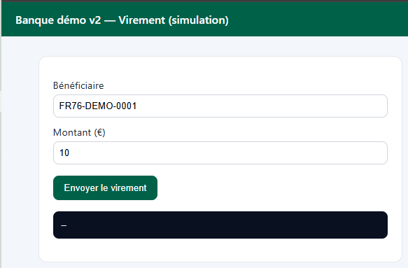
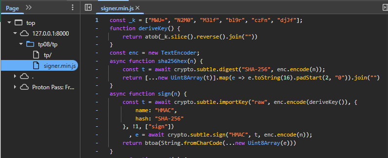
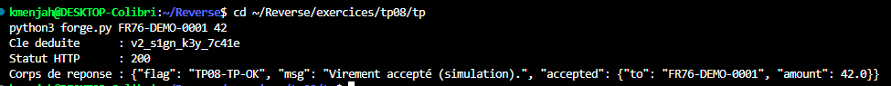
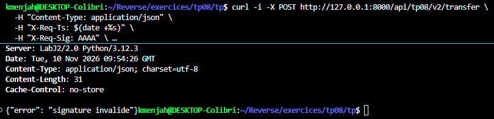

# TP08 — Travail individuel`/tp08/tp/` : rapport

## Aperçu



## Contexte

Client `tp08/tp/signer.min.js` : signe chaque virement avant envoi. Minifié,
sans source map. Clé, message signé, encodage et en-têtes diffèrent de la
démonstration (`tp08/signer.min.js`). Objectif : écrire `forge.py`, qui
obtient un `200` sans navigateur.

## Méthode

```js
const _k = ["MWU=", "N2M0", "M3lf", "bl9r", "czFn", "djJf"];
function deriveKey() { return atob(_k.slice().reverse().join("")); }

async function sign(message) {
  const key = await crypto.subtle.importKey("raw", enc.encode(deriveKey()),
      { name: "HMAC", hash: "SHA-256" }, false, ["sign"]);
  const mac = await crypto.subtle.sign("HMAC", key, enc.encode(message));
  return btoa(String.fromCharCode(...new Uint8Array(mac)));
}

async function send(payload) {
  const path = "/api/tp08/v2/transfer";
  const ts = Math.floor(Date.now() / 1000).toString();
  const body = JSON.stringify(payload);
  const message = [ts, "POST", path, await sha256hex(body)].join("|");
  return fetch(path, {
    method: "POST",
    headers: { "X-Req-Ts": ts, "X-Req-Sig": await sign(message) },
    body
  });
}
```

Vu dans Sources (`tp08/tp/signer.min.js`, pretty-print) :



## 1. Éléments retrouvés

- **Clé** : tableau `_k` de 6 morceaux base64, inversé puis concaténé puis
  décodé (`atob`) → `v2_s1gn_k3y_7c41e`.
- **Message signé** : `"<timestamp>|POST|<chemin>|<sha256 hex du corps>"`,
  avec `<chemin> = /api/tp08/v2/transfer`.
- **Signature** : HMAC-SHA256(clé, message), encodée en **base64** (la
  démonstration l'encode en hexadécimal : c'est la différence à repérer).
- **En-têtes** : `X-Req-Ts` (timestamp), `X-Req-Sig` (signature).
- **Fenêtre de validité** : ±30 s (imposée côté serveur, indépendante du
  client).

## 2. Solveur — `forge.py`

[`tp/forge.py`](tp/forge.py), sans dépendance externe (`hmac`, `hashlib`,
`base64`, `urllib` de la bibliothèque standard).

```
$ python3 tp/forge.py FR76-DEMO-0001 42
Cle deduite      : v2_s1gn_k3y_7c41e
Statut HTTP      : 200
Corps de reponse : {"flag": "TP08-TP-OK", "msg": "Virement accepté (simulation).", ...}
```



## 3. Contre-épreuve

Une requête avec une signature volontairement fausse, hors de `forge.py` :

```
curl -i -X POST http://127.0.0.1:8000/api/tp08/v2/transfer \
  -H "Content-Type: application/json" -H "X-Req-Ts: $(date +%s)" \
  -H "X-Req-Sig: AAAA" -d '{"to":"FR76-DEMO-0001","amount":999}'
```

→ `401 Unauthorized`, `{"error": "signature invalide"}` — confirme que le
serveur vérifie réellement la signature, et que `forge.py` ne passe que
parce qu'il la calcule correctement.



## Réponse à la question de restitution

*Que protège une signature calculée par le client ?* Peu de chose : elle
peut détecter une modification en transit par un tiers qui ne connaît pas la
clé, mais puisque la clé voyage dans le code envoyé au navigateur, quiconque
le lit (comme on vient de le faire) peut signer n'importe quel message
lui-même — exactement ce que fait `forge.py`.

*Que changerait un secret qui ne quitte jamais le serveur ?* Si la clé de
signature restait côté serveur (par exemple : la signature est calculée par
le serveur après authentification, pas par le client), le client ne pourrait
plus forger une requête valide sans passer par une session légitime. C'est
la même conclusion que le TP07 : un contrôle de sécurité doit vivre côté
serveur, jamais dans ce qui est envoyé au client.
