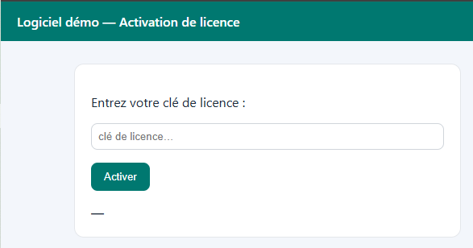
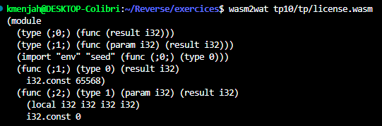
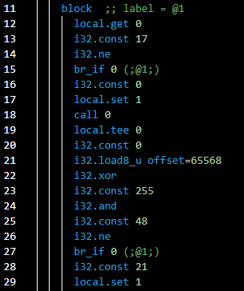
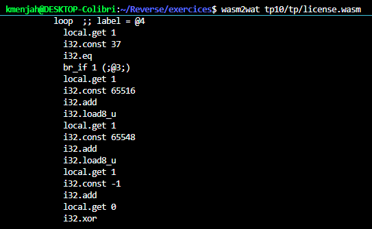
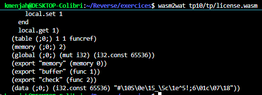
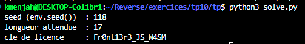
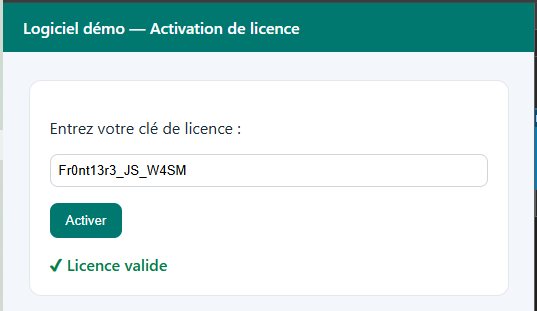

# TP10 — Travail individuel `/tp10/tp/` : rapport

## Aperçu


**Figure — Aperçu.** Page `/tp10/tp/`, « Logiciel démo — Activation de
licence ».

## Contexte

Module `tp10/tp/license.wasm` : compilé sans section `name`, non exposé dans
`window`. Objectif : retrouver la clé de licence sans lire de clé en clair
dans le module, et écrire un solveur Python.

## Méthode

```
sudo apt install -y wabt
wasm2wat tp10/tp/license.wasm -o tp10/tp/license.wat
```

Lecture seule, aucune exécution du code de licence à ce stade. Le fichier
`license.wat` obtenu est ouvert dans l'éditeur ; les 4 captures ci-dessous en
montrent les parties utiles, dans l'ordre où le code s'exécute.

## 1. Où la clé saisie est écrite


**Figure 1 — Début du fichier `.wat`.** L'import `env.seed` (ligne 4) et la
fonction exportée `buffer` (lignes 5-6, `func (;1;)`) : elle renvoie
`i32.const 65568`. C'est l'adresse mémoire où le JavaScript écrit les
caractères tapés dans le champ, avant d'appeler `check`.

## 2. La règle du premier caractère


**Figure 2 — Début de `check`.** Dans l'ordre : `i32.const 17 / i32.ne`
(la longueur doit être 17), `call 0` (appel à `env.seed`, donc au
JavaScript — c'est la **frontière JS ↔ WASM** de l'énoncé), puis
`i32.load8_u offset=65568` (lecture du premier caractère saisi), `i32.xor`,
et `i32.const 48 / i32.ne` (comparaison : si le résultat n'est pas `48`,
refuser).

`seed` vient de l'import `env.seed`. Dans `tp10/tp/app.js` :

```js
const imports = { env: { seed: () => [..."licence"].reduce((e, t) => e ^ t.charCodeAt(0), 29) } };
```

On part de `29`, puis on fait un XOR avec le code ASCII de chaque lettre de
`"licence"`, une par une. Le résultat : **`seed = 118`**.

La règle du premier caractère est donc : `118 ^ cle[0] == 48`.

## 3. La règle de la boucle (les 16 caractères suivants)

Carte mémoire du module : la table occupe les adresses `65536` à `65552`
(17 octets, `table[0]` à `table[16]`), l'entrée saisie occupe `65568` à
`65584` (`entrée[0]` à `entrée[16]`) — un écart constant de `32`.


**Figure 3 — Boucle de `check`.** Le compteur (`local 1`) part de `21`
(dernière ligne de la Figure 2) et la boucle s'arrête à `37`
(`i32.const 37 / i32.eq / br_if`). Premier tour, `compteur = 21` :

1. Lecture à l'adresse `21 + 65516 = 65537`. Comme `65537 - 65536 = 1`,
   c'est **`table[1]`**.
2. Lecture à l'adresse `21 + 65548 = 65569`. Comme `65569 - 65568 = 1`,
   c'est **`entrée[1]`**.
3. Comparaison : `table[1]` doit valoir `entrée[1] ^ (21-1) ^ seed`, soit
   `entrée[1] ^ 20 ^ 118`.

Si ça correspond, le même tour (`compteur` toujours à `21`) enchaîne une
seconde vérification avant de passer au tour suivant (la suite du code, pas
visible sur cette capture mais de même forme) :

4. Lecture à l'adresse `21 + 65517 = 65538` → `table[2]`.
5. Lecture à l'adresse `21 + 65549 = 65570` → `entrée[2]`.
6. Comparaison : `table[2]` doit valoir `(21 ^ 118) ^ entrée[2]`.

**Un seul tour de boucle vérifie donc deux positions** (une impaire, une
paire). Au tour suivant, `compteur = 23`, et ce sont `entrée[3]` /
`entrée[4]` qui sont vérifiés, et ainsi de suite jusqu'à `compteur = 35`
(`entrée[15]` / `entrée[16]`) — d'où l'arrêt à `37`.

En généralisant à n'importe quelle position `k` (1 à 16) :

```
table[k] == entrée[k] ^ (k + 19) ^ seed
```

## 4. Inverser les deux règles

Propriété du XOR : si `a ^ b = c`, alors `a = b ^ c`. En appliquant ça aux
deux règles des points 2 et 3 :

```
cle[0] = seed ^ 48
cle[k] = table[k] ^ (k + 19) ^ seed          pour k = 1 a 16
```


**Figure 4 — Fin du fichier `.wat`.** Le segment `data` (dernière ligne)
donne les 17 octets de la table, en mêlant caractères imprimables et codes
`\xx` en hexadécimal :

```
table = [35, 16, 83, 14, 21, 95, 92, 30, 94, 53, 33, 59, 54, 1, 99, 7, 24]
```

Les exports `memory`, `buffer` (func 1) et `check` (func 2) confirment la
correspondance avec les figures précédentes.

**Calcul des deux premiers caractères, à la main, pour vérifier la méthode :**

```
cle[0] = seed ^ 48                 = 118 ^ 48          = 70   -> 'F'
cle[1] = table[1] ^ (1+19) ^ seed  = 16 ^ 20 ^ 118      = 114  -> 'r'
```

Les lettres `F`, `r` sont bien les deux premiers caractères du résultat
final.

## 5. Solveur Python

[`tp/solve.py`](tp/solve.py) applique exactement ces deux formules, en
boucle sur les 17 positions :

```python
TABLE = [35, 16, 83, 14, 21, 95, 92, 30, 94, 53, 33, 59, 54, 1, 99, 7, 24]

def compute_seed():
    seed = 29
    for ch in "licence":
        seed ^= ord(ch)
    return seed

def solve():
    seed = compute_seed()
    key = [seed ^ 0x30] + [TABLE[k] ^ (k + 19) ^ seed for k in range(1, 17)]
    return bytes(key).decode("ascii")
```


**Figure 5 — Exécution de `solve.py`.** `seed = 118`, longueur `17`, clé
`Fr0nt13r3_JS_W4SM`.

## 6. Validation

```
check("Fr0nt13r3_JS_W4SM") = 1   →  cle valide
check("0000000000000000")  = 0   →  contre-epreuve, cle fausse refusee
```

(vérifié en exécutant réellement le module avant la séance, avec
`WebAssembly.instantiate` et l'import `env.seed` reproduit)


**Figure 6 — Validation.** La clé `Fr0nt13r3_JS_W4SM` saisie sur
`/tp10/tp/` donne « ✔ Licence valide ».

## Réponse à la question de restitution

Le module, la table et la fonction `seed` arrivent tous les trois dans le
navigateur : rien n'empêche de les lire (comme ici) ou de patcher le module
(`wasm2wat` → éditer la comparaison → `wat2wasm`) pour qu'il accepte
n'importe quelle clé. Tant que la vérification s'exécute chez le client, elle
est lisible et modifiable — WASM compris, malgré l'apparence de bytecode
compilé. Seule une vérification faite côté serveur, sur une valeur que le
client ne peut ni lire ni changer, constitue un vrai contrôle.
