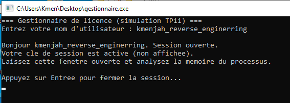
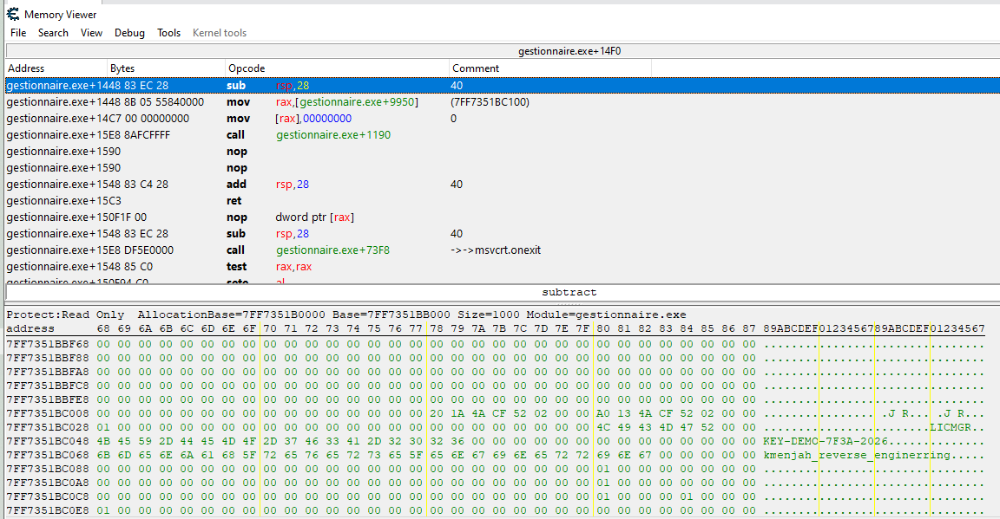
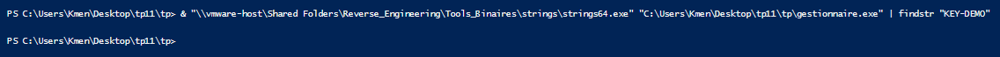
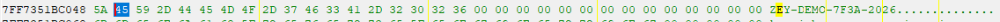
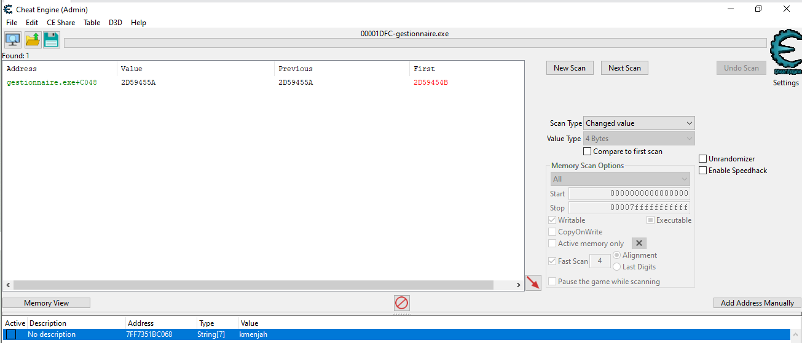

# TP11 — Travail individuel `tp11/tp/` : rapport

## Aperçu



Fenêtre de `gestionnaire.exe` après saisie du nom repère, session ouverte et en attente (avant toute manipulation dans Cheat Engine).

## Contexte

Cible : `tp11/tp/gestionnaire.exe`, VM Windows isolée (TP11-14). Une clé de session existe **uniquement en RAM**, le temps que le programme tourne ; elle n'est jamais écrite en clair sur le disque. Objectif : la lire dans la mémoire du processus avec Cheat Engine, sans modifier le code.

## Méthode

1. Lancer `gestionnaire.exe`, saisir un nom repère : `kmenjah_reverse_enginerring`.
2. Cheat Engine (administrateur) → *File → Open Process* → `gestionnaire.exe`.
3. *Value Type* = **String**, valeur = le nom repère, *First Scan*.
4. Ouvrir la région trouvée (*Browse this memory region*) et lire les octets situés juste après le nom.

## 1. Clé trouvée en mémoire

Après *First Scan* (String) sur le nom repère, ouverture de la région trouvée (*Browse this memory region*) : le nom repère et la clé sont stockés côte à côte dans la même zone mémoire du processus.



Adresse mémoire de la clé : `0x7FF351BC048`

Clé lue : `KEY-DEMO-7F3A-2026`

(Juste avant, à `0x7FF351BC028`, la chaîne `LICMGR` — un identifiant interne du gestionnaire de licence, visible dans la même région.)

## 2. Absence du secret sur le disque

Preuve que la clé n'apparaît **pas** dans le fichier `.exe` (hors du processus en cours d'exécution) :

```powershell
& "\\vmware-host\Shared Folders\Reverse_Engineering\Tools_Binaires\strings\strings64.exe" "C:\Users\Kmen\Desktop\tp11\tp\gestionnaire.exe" | findstr "KEY-DEMO"
```



Aucune ligne renvoyée : la chaîne `KEY-DEMO` n'apparaît nulle part dans le fichier `gestionnaire.exe` sur le disque.

**Pourquoi `strings` sur le fichier ne révèle rien** : la clé est générée (ou déchiffrée) par le programme **au moment de l'exécution**, et stockée seulement dans la mémoire vive allouée au processus. Le fichier sur disque ne contient que le code qui la produit, pas la valeur elle-même — c'est pour ça qu'une analyse purement statique (lecture du binaire) ne peut pas la trouver : il faut l'attraper pendant que le programme tourne.

## Bonus — valeur inconnue et modification mémoire

**Unknown initial value** : *New Scan* → *Value Type* = 4 Bytes → *Scan Type*
= **Unknown initial value** → *First Scan* (instantané complet de la mémoire du processus, `Found: 61 440`, sans filtrer sur aucune valeur).

Modification directe de la clé dans le *Memory Viewer*, à `0x7FF351BC048` :
premier octet `4B` (`K`) remplacé par `5A` (`Z`), donnant `ZEY-DEMO-7F3A-2026` :



Retour au scan, *Scan Type* = **Changed value**, **Next Scan** :



**Un seul résultat** : `gestionnaire.exe+C048` (= `0x7FF351BC048`), avec `First = 2D59454B` (valeur d'origine, octets `4B 45 59 2D` lus en little endian) et `Value/Previous = 2D59455A` (après modification, `5A 45 59 2D`).
La technique « valeur inconnue au départ, puis filtrage sur ce qui a changé » retrouve exactement l'adresse modifiée, sans qu'il ait été nécessaire de connaître une valeur à chercher au départ.

Ceci démontre aussi la deuxième partie du bonus : la mémoire d'un processus vivant n'est pas seulement **lisible** depuis l'extérieur, elle est aussi **modifiable** — Cheat Engine a bien écrit dans la mémoire de `gestionnaire.exe`, un processus qui n'est pourtant pas le sien.

## Réponse à la question de restitution

Puisque tout secret finit en clair dans la RAM à un moment donné (ne serait-ce que pour être utilisé), rien ne protège une clé **contre un accès à la mémoire du processus qui la détient** — c'est structurellement inévitable.
Ce qu'on peut réellement faire, c'est **ralentir** et **réduire la fenêtre d'exposition** : limiter la durée de vie de la clé en mémoire (l'effacer dès qu'elle n'est plus utile), isoler le processus qui la manipule des autres (empêcher un processus tiers d'ouvrir le sien), et surtout ne jamais compter sur « c'est en mémoire donc c'est caché » comme un contrôle de sécurité en soi.
