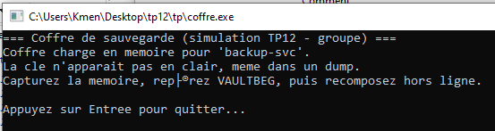
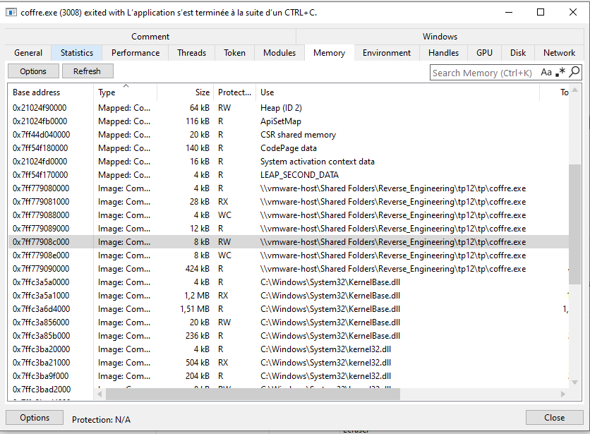
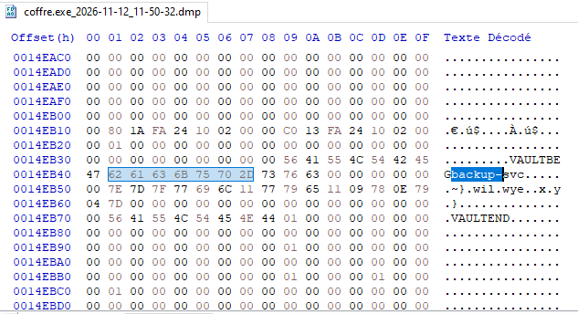
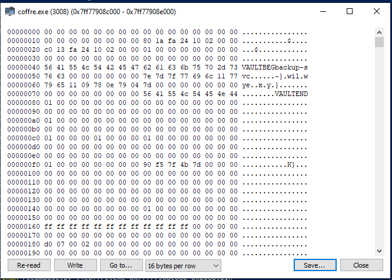
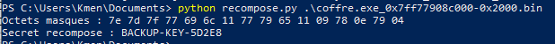

# TP12 — Travail individuel `tp12/tp/` : rapport

## Aperçu



Fenêtre de `tp12\tp\coffre.exe` au lancement : "Coffre de sauvegarde
(simulation TP12 - groupe)", chargé en mémoire pour `backup-svc`, clé non
affichée, en attente (avant le dump).

Chemin du module confirmé dans System Informer (onglet Mémoire) :
`\\vmware-host\Shared Folders\Reverse_Engineering\tp12\tp\coffre.exe`.



## Contexte

Cible : `tp12/tp/coffre.exe`. Objectif : prendre un instantané (*dump*) de la
mémoire du processus avec System Informer, puis retrouver hors ligne un
secret masqué dans ce dump — comme un analyste qui reçoit une image mémoire
après coup, sans processus vivant à interroger.

## Méthode

1. Lancer `tp12\tp\coffre.exe`, laisser la fenêtre ouverte.
2. System Informer → clic droit sur le processus → *Create dump file → Full*.
3. Ouvrir le dump dans **HxD**, chercher le marqueur `VAULTBEG` **depuis le
   début du fichier**. Le dump contient plusieurs occurrences du texte
   `VAULTBEG` (le code machine qui le construit, le texte d'aide du
   programme) en plus de la vraie structure en mémoire — seule celle suivie
   peu après de `VAULTEND` est la bonne.
4. Relever les octets du champ secret juste après le marqueur et
   l'identifiant (le secret est masqué, donc illisible tel quel).
5. Compléter les deux trous de `tp/recompose.py` (octet de XOR, longueur du
   secret), puis lancer `python recompose.py <dump>`.

## 1. Repérage dans le dump (HxD)

Structure trouvée (`beg[8] | user[16] | secret[17] | end[8]`), à l'offset
`0x14EB39` du dump :



- `VAULTBEG` : `0x14EB39`–`0x14EB40`
- Identifiant (`user`) : `backup-svc` + remplissage de zéros jusqu'à 16
  octets, `0x14EB41`–`0x14EB50`
- Secret masqué (17 octets) : `0x14EB51`–`0x14EB61` →
  `7E 7D 7F 77 69 6C 11 77 79 65 11 09 78 0E 79 04 7D`
- `VAULTEND` : `0x14EB62`–`0x14EB69`

Sélection confirmée (33 octets = identifiant + secret) :



## 2. Octet de XOR et longueur du secret

Octet de XOR trouvé : `0x3C`

Longueur du secret : `17` octets

Déduit à partir d'un octet masqué dont la valeur (`0x11`) était nettement
différente du reste de la série, en supposant qu'il s'agissait d'un
séparateur `-` (`0x2D`) : `0x11 ^ 0x2D = 0x3C`. Appliqué à l'ensemble des 17
octets masqués, ce XOR donne un texte entièrement lisible — confirmation
que c'est la bonne clé.

**Calcul détaillé** (XOR est son propre inverse : si `masqué = clair XOR clé`,
alors `clair = masqué XOR clé`), appliqué aux 17 octets masqués avec
`clé = 0x3C` :

| octet masqué | XOR 0x3C | caractère |
|--------------|----------|-----------|
| 7E           | 42       | B         |
| 7D           | 41       | A         |
| 7F           | 43       | C         |
| 77           | 4B       | K         |
| 69           | 55       | U         |
| 6C           | 50       | P         |
| 11           | 2D       | -         |
| 77           | 4B       | K         |
| 79           | 45       | E         |
| 65           | 59       | Y         |
| 11           | 2D       | -         |
| 09           | 35       | 5         |
| 78           | 44       | D         |
| 0E           | 32       | 2         |
| 79           | 45       | E         |
| 04           | 38       | 8         |
| 7D           | 41       | A         |

→ `BACKUP-KEY-5D2E8A`

**Méthode pour le retrouver sans tâtonner (bonus)** : un octet du clair est
connu à l'avance (par exemple un tiret `-`, `0x2D`, si le format du secret en
contient un à position fixe). XOR est réversible : si `masqué = clair ^ clé`,
alors `clé = masqué ^ clair`. En XORant l'octet masqué observé à cette
position avec l'octet clair attendu (`0x2D`), on obtient directement la clé
de XOR, sans avoir à essayer toutes les valeurs possibles.

## 3. Clé recomposée

```
python recompose.py coffre.exe_2026-11-12_11-50-32.dmp
```



Clé recomposée : `BACKUP-KEY-5D2E8A`

## Réponse à la question de restitution

Entre un secret **lisible** et un secret **masqué** dans le dump : ça ne change rien sur le fond — dans les deux cas, le secret est entièrement présent dans la mémoire capturée, donc entièrement récupérable par qui a accès au dump. Le masquage (ici un simple XOR) ne retire aucune information, il **retarde** seulement la lecture directe : il faut un octet de référence ou un peu de tâtonnement pour l'inverser, mais rien de plus. Pour un
analyste, la différence est donc une question de **temps d'analyse**, pas de possibilité d'accès : un masquage réversible n'est pas un chiffrement avec clé secrète protégée, c'est juste de l'obfuscation.
