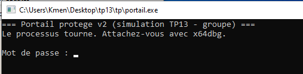
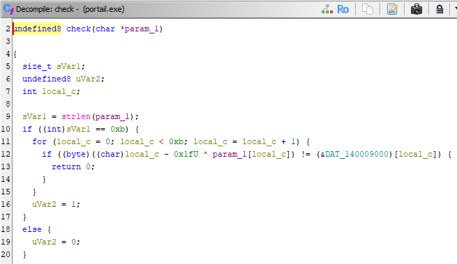
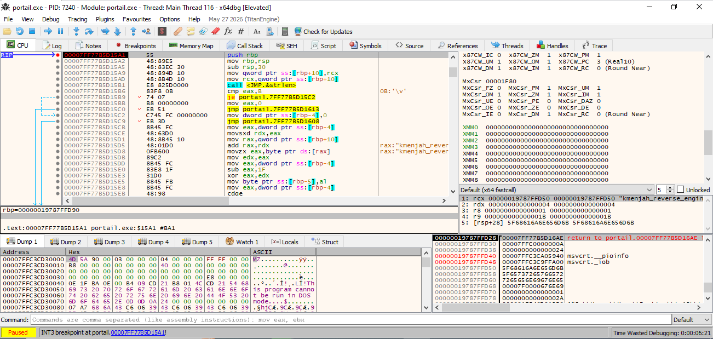
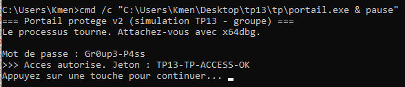
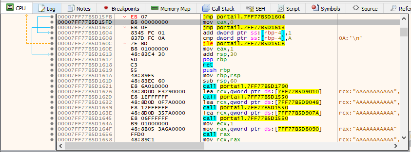

# TP13 — Travail de groupe `tp13/tp/` : rapport

## Aperçu



Fenêtre de `tp13\tp\portail.exe` : "Portail protege v2 (simulation TP13 -
groupe)", en attente d'un mot de passe, en boucle.

## Contexte

Cible : `tp13/tp/portail.exe`, déjà lancée et en attente d'un mot de passe.
Objectif : s'attacher au processus **déjà actif** avec x64dbg, intercepter la vérification au moment où elle a lieu — ici pas de comparaison simple (`strcmp`), chaque caractère saisi est transformé par un XOR à clé glissante avant d'être comparé à une table, donc le mot de passe n'apparaît jamais en clair dans un registre.

## Méthode

1. Lancer `portail.exe`, le laisser tourner.
2. Ghidra, à froid : importer `portail.exe` (nouveau projet, *Import File*, puis analyse par défaut), repérer la fonction `check` dans le décompilateur.
3. x64dbg (administrateur) → *File → Attach* → `portail.exe`.
4. Poser un point d'arrêt sur `check` (ici par adresse, `portail.exe+15A1` —
   le nom `check` n'étant pas résolu, aucun symbole PDB chargé), saisir une valeur dans la fenêtre cible pour déclencher l'arrêt.

## 1. Fonction `check` repérée (Ghidra, à froid)



```c
undefined8 check(char *param_1)
{
  size_t sVar1;
  undefined8 uVar2;
  int local_c;

  sVar1 = strlen(param_1);
  if ((int)sVar1 == 0xb) {
    for (local_c = 0; local_c < 0xb; local_c = local_c + 1) {
      if ((byte)((char)local_c - 0x1fU ^ param_1[local_c]) != (&DAT_140009000)[local_c]) {
        return 0;
      }
    }
    uVar2 = 1;
  }
  else {
    uVar2 = 0;
  }
  return uVar2;
}
```

Autrement dit : longueur attendue 11, puis pour chaque caractère `i`,
`((i - 0x1F) XOR caractère[i])` doit être égal à l'octet `table[i]` (table
lue à l'adresse `DAT_140009000`).

Table de comparaison (11 octets) : `A6 90 D3 91 95 D5 CA B8 DD 99 98`

x64dbg arrêté pile à l'entrée de `check` (`portail.exe+15A1`), confirmant
l'adresse trouvée dans Ghidra :



## 2. Méthode choisie

Méthode : **inversion**. XOR étant réversible, `mot_de_passe[i] = table[i] ^ ((i - 0x1F) mod 256)` — calculable caractère par caractère sans avoir besoin de patcher le programme.

Clé de transformation : `(i - 0x1F) mod 256`, glissante selon la position `i` du caractère (0 à 10).

**Calcul détaillé** (XOR est son propre inverse : si `a XOR b = c`, alors `a = b XOR c`) :

```
caractère[i] = table[i] XOR ((i - 0x1F) mod 256)
```

Exemple pour `i = 0` :

- `i - 0x1F` = `0 - 31` = `-31`, qui "boucle" sur un octet (0–255) en `0xE1`
- `table[0]` = `0xA6`
- `caractère[0]` = `0xA6 XOR 0xE1` = `0x47` = `'G'`

En répétant le calcul pour `i = 0` à `10` (`i - 0x1F` qui vaut successivement `0xE1, 0xE2, ..., 0xEB`) :

| i  | table[i] | (i-0x1F) | XOR | caractère |
| -- | -------- | -------- | --- | ---------- |
| 0  | A6       | E1       | 47  | G          |
| 1  | 90       | E2       | 72  | r          |
| 2  | D3       | E3       | 30  | 0          |
| 3  | 91       | E4       | 75  | u          |
| 4  | 95       | E5       | 70  | p          |
| 5  | D5       | E6       | 33  | 3          |
| 6  | CA       | E7       | 2D  | -          |
| 7  | B8       | E8       | 50  | P          |
| 8  | DD       | E9       | 34  | 4          |
| 9  | 99       | EA       | 73  | s          |
| 10 | 98       | EB       | 73  | s          |

Mot de passe recalculé : **`Gr0up3-P4ss`**

## 3. Accès autorisé

Vérifié en relançant `portail.exe` via un terminal gardé ouvert (`cmd /c "...\portail.exe & pause"`), pour voir le résultat avant la fermeture automatique de la fenêtre :



`Mot de passe : Gr0up3-P4ss` → `Acces autorise. Jeton : TP13-TP-ACCESS-OK`

## Bonus — contournement (patch)

En plus de l'inversion, la seconde méthode (contournement) a été mise en pratique sur l'instruction de décision par caractère, à `portail.exe+15FB` (`JZ`, qui décide si le caractère courant est accepté) : patchée en `JMP` inconditionnel via l'assembleur intégré de x64dbg (Espace → `jmp 0x00007FF77B5D1604`, même adresse de destination que le `JZ` d'origine), pour que chaque caractère soit accepté sans vérification.



Ce patch à lui seul suffit en principe à obtenir l'accès avec n'importe quelle entrée de 11 caractères, sans connaître le mot de passe — démontrant concrètement qu'un débogueur permet de **modifier le code en mémoire**, pas seulement de le lire. La preuve "Accès autorisé" retenue pour ce rapport reste toutefois celle obtenue par inversion (point 3 ci-dessus), méthode la plus fiable et déjà entièrement vérifiée.

## Réponse à la question de restitution

Une fois attaché à un processus, on peut **tout lire** (registres, mémoire, pile) et **tout modifier** (patcher une instruction, forcer un drapeau, changer une valeur en mémoire) — il ne reste donc aucune protection *locale* réelle : le code et les données du programme sont entièrement à la merci de qui contrôle la machine sur laquelle il tourne. Ce qui reste comme protection véritable, c'est ce qui **ne se trouve jamais sur cette machine** : une vérification faite par un serveur distant, sur un secret que le client ne détient à aucun moment (même pas transformé), est la seule chose qu'un débogueur attaché localement ne peut pas contourner.
